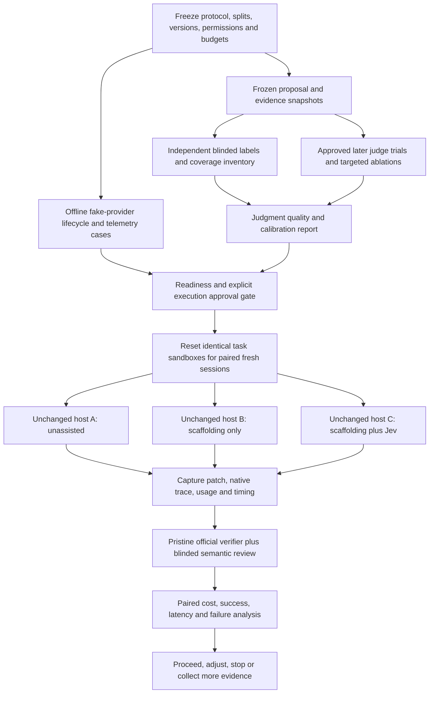

# Evaluation plan: useful judgments, cheaper correct implementations

**Status: proposed protocol, not executed.** Research reviewed on **2026-10-11**.
This assignment authorizes changes only to this document. The latest user instruction
conditionally authorizes the first **offline implementation after planning is complete**;
it does not authorize budgeted model evaluation, dataset acquisition, host runs, or
live experiments here. CLI-first consultation and human-confirmed scoped
session/repository consent are accepted direction. No Hunchcraft behavior, evaluation
runner, labeled corpus, measured baseline, or measured gain exists.

This plan studies the direction in [design discussion](design-discussion.md) and the
canonical [proposed v0 system design](system-design.md): an LLM emits a compact
proposal; Jev judges checks against the **original request and source evidence**;
raw advisory output may prompt targeted expansion or revision. The canonical brief
fields and `component-outline.v0` check set are the proposal selected for the first
offline implementation, pending final review, not aliases owned by this evaluation
plan. Evaluation trials remain separately gated and unexecuted; a live benefit study
is not a prerequisite for starting the conditionally authorized offline implementation.

## Recommendation in brief

The dataset and method recommendation remains a **proposed layered, paired
evaluation**, not an executed study or one leaderboard score:

1. Offline fake-provider contract tests establish bookkeeping and bounded failure,
   not semantic accuracy or agent value.
2. Frozen, independently labeled proposal/evidence cases establish whether the
   bounded checks work, including false alarms on valid plans and necessary tests.
3. A small existing-host end-to-end pilot compares **unassisted host**, **identical
   scaffolding without Jev**, and **scaffolding with Jev**. It measures the cost of
   completing the implementation task, including unsuccessful attempts.
4. Confirm on untouched product-relevant tasks plus a stratified **SWE-bench Pro V2
   public subset**, then expand only if the pilot justifies the expense. Use
   SWE-bench Verified as an optional compatibility/diagnostic set, not the sole
   frontier-quality claim. Reserve Terminal-Bench for relevant terminal workflows;
   Aider polyglot is a narrow editing control, not an architecture benchmark.
5. Test same-artifact LLM review and synchronous/background timing **after** the
   primary comparison, where the failure analysis makes them informative. Avoid an
   expensive full factorial before there is a viable consultation loop.

There is no evidence yet identifying the biggest gain. The most promising **testable
candidate**, not a finding, is catching an actionable requirement omission or
source contradiction before expensive implementation/rework. Easy correct tasks
are equally important: they reveal whether consultation simply adds overhead.

## 1. Bounded decision and falsifiable hypotheses

### What is being decided?

At one observable planning checkpoint, assess whether a provisional component
outline needs focused attention before implementation: an uncovered requested
outcome, a contradicted mechanism, insufficient supporting evidence, or unjustified
scope. Keep these dimensions separate. Necessary testing, compatibility work,
cleanup, and lifecycle handling can justify components indirectly.

For a future v0 experiment, feedback is **advisory**: it can suggest checking evidence or
revising the implicated part. A positive result is not correctness certification
or action permission. Jev does not automatically delete components/tests, change
source, suppress verification, or override user/repository requirements. Test
necessity and cleanliness claims require independent evaluation, not Jev self-grade.
Use the canonical fields, limits, compiler and renderer in
[system design sections 6–9](system-design.md#6-brief-schema-provenance-and-strict-parsing).
Freeze their versions and the agent instructions before any trial; no competing
product schema or independently chosen check names are introduced here.

### Canonical v0 scope and raw delivery

The selected proposal is one-shot foreground CLI consultation, not a background
worker or an evaluation runner. Its mandatory check IDs are `g.request-gap`,
`g.domain-gap`, `r.<id>.gap`, `c.<id>.contradiction`, `c.<id>.evidence-gap`,
`c.<id>.plausibility`, `c.<id>.justification`, `l.<id>.mismatch`, and
`q.<id>.condition`; meanings, binding, order and literal criteria come from
[the canonical compiler](system-design.md#7-mandatory-versioned-check-compiler).
Plausibility and justification use **Score levels 0–2**, not approval probabilities.
Other v0 checks use Noul; Choice is not part of this slice.

The [v0 renderer](system-design.md#94-feedback-renderer-and-next-action) exposes
**all checks and raw answers**, including Score distributions, in compiler order.
There is no numeric filter, high/medium/low classification, or production flag
threshold. Valid low-probability/uncertain answers remain present; unavailable
service is a no-judgment failure, not semantic abstention or a low Score.
All thresholded precision/recall, “analytic flags,” selective coverage–risk and
operating-point references below are evaluator-side analyses: fit on dev and freeze
for held-out test. They do **not** describe which v0 results are delivered or read.
Measure actual exposure, interpretation and harms from reading the whole raw output,
including answers an analytic threshold would discard. Thresholded delivery would
be a separately versioned treatment with new controls, approval and held-out trials.

### Units and baseline

| Level               | Unit of evaluation                                                              | Baseline                                                                                                    |
| ------------------- | ------------------------------------------------------------------------------- | ----------------------------------------------------------------------------------------------------------- |
| Contract            | A deterministic lifecycle/event scenario                                        | Expected behavior with fake providers and no assistance                                                     |
| Judgment            | One exact question over a frozen request/proposal/evidence snapshot             | Dev-fitted constant/class-prior predictor; same-artifact LLM review where approved                          |
| Proposal            | All applicable checks for one proposal snapshot                                 | Independently labeled original proposal, including issues that no generated check names                     |
| End-to-end          | One fresh host session attempting one implementation task within a fixed budget | The same unchanged coding host/model, normal task/repo instructions, no Hunchcraft skill, tool, or feedback |
| Statistical pairing | Task × repetition block, with a fresh reset per arm                             | Matched arms in randomized order; repeated trials are not new independent tasks                             |

**Primary efficiency hypothesis:** compared with the unassisted host, Hunchcraft
reduces total runtime cost per correct completion by a practically meaningful amount
without an unacceptable reduction in success-at-budget. Compare against the
scaffolding-only arm as well before attributing any gain to Jev.

Before held-out runs, register `minimum_cost_reduction`,
`maximum_success_loss_pp` (percentage points), `maximum_latency_increase`,
`maximum_harmful_advice_rate`, and the chosen confidence-interval decision rule.
No defensible values are known yet. The user must select business tolerances using
pilot cost/variance, not a cookbook threshold. A preregistration with these fields
unset is **not ready to execute confirmatory evaluation**.

| Hypothesis                              | Evidence that would support it                                                                           | Evidence against it                                                                                     |
| --------------------------------------- | -------------------------------------------------------------------------------------------------------- | ------------------------------------------------------------------------------------------------------- |
| Useful bounded judgments                | Held-out global detection and localized issue recall beat trivial baselines under preregistered matching | Confident false alarms, missed omissions, or unsafe rejection of needed support work                    |
| Practical implementation improvement    | Primary cost/quality rule holds for assisted vs unassisted, and Jev adds value vs scaffolding-only       | Savings disappear when brief/evidence costs and failures are included; quality worsens beyond tolerance |
| Jev rather than just scaffolding/review | Incremental assisted-vs-scaffolding gain; competitive cost/quality vs same-artifact LLM review           | Scaffolding accounts for the lift, or an ordinary second review dominates Jev                           |
| Useful background timing                | Lower visible waiting with timely fresh uptake and no unacceptable outcome loss vs synchronous delivery  | Results arrive too late, are stale/unused, or require equivalent blocking at consumption                |

Decision accuracy and implementation success are separate outcomes. Good judgment
labels cannot establish cheaper coding, and successful code cannot establish that
Jev judged correctly. Shorter prose, fewer displayed turns, or a shorter proposal
does not establish less internal reasoning/compute.

### Two different meanings of “implementation cost”

- **Primary:** the cost of an agent implementing the user's task: all main-model,
  Jev, helper-model, retrieval, tool, and runtime overhead incurred by the workflow.
- **Separate investment ledger:** engineering Hunchcraft, authoring rubrics/skills,
  constructing datasets, annotation, tuning, evaluation infrastructure, and running
  the experiments. These are not runtime savings. Report human hours and paid
  costs separately; amortization is an explicit scenario, not silently free setup.

## 2. What established benchmarks can and cannot tell us

### Research findings that change the choice

**Verified is useful but not sufficient.** The original release describes 500
human-validated issue/PR tasks from Python repositories and both fail-to-pass and
pass-to-pass grading [S1–S3]. OpenAI's February 2026 audit reports material issues in
59.4% of **138 selected, frequently failed tasks**, not 59.4% of the entire dataset.
It also reports contamination examples across tested model families and recommends
Pro instead [S4]. This is a vendor audit with a selected sample, not proof every
Verified result is invalid or every current model is contaminated. It is sufficient
reason not to use Verified alone for a frontier generalization claim.

**Pin Pro's release, not its name.** The live repository and dataset card describe
V2, released 2026-09-22: **642 tasks across 11 repositories**, with Go/Python/JS/TS
counts **256/237/145/4**, respectively [S5–S6]. The public leaderboard still describes
the older **731-task** public split and mixes capped/uncapped historical protocols
[S7]. Do not merge those numbers or treat its scores as our baseline. V2 revises
instructions/tests/images, provides checksums, and recommends a network-restricted
agent phase plus pristine-sandbox patch re-grading. The maintainers' reference/empty
patch validation is upstream evidence, **not a locally reproduced result**.

**Timing/resource conditions are part of the treatment.** Anthropic's resource
study reports different scores under different CPU/RAM enforcement in Terminal-Bench
2.0 and a smaller analogous effect in SWE-bench [S15]. Its particular multipliers
are not universal prescriptions. Record resource reservation and hard-kill limits,
not merely “Docker”; interleave arms across time blocks to reduce provider-load bias.

### Dataset selection table

| Candidate                                   | Match to this proposal                                                                                      | Evaluation and burden                                                                                                                       | Recommendation and limits                                                                                                                                                                      |
| ------------------------------------------- | ----------------------------------------------------------------------------------------------------------- | ------------------------------------------------------------------------------------------------------------------------------------------- | ---------------------------------------------------------------------------------------------------------------------------------------------------------------------------------------------- |
| Newly authored tasks on pinned public repos | Strongest match to compact component planning, requirement coverage, support work, feature/regression tasks | Requires trustworthy reference solutions, private acceptance tests, annotation, and clean sandboxes                                         | Primary product-relevance track. Avoid using Hunchcraft itself as the only task repo; bespoke tasks can overfit our favored failure patterns                                                   |
| SWE-bench Pro **V2 public**                 | Real multi-file implementation tasks, explicit requirements/interfaces, several languages                   | Harbor-format tasks, public Linux/amd64 images, hidden verifiers, fresh-sandbox re-grade; upstream locked protocol uses 50 minutes/task     | Primary established external track after pilot. Sample randomly within predeclared strata. Only four TS-labeled tasks: not a TypeScript product proxy. Long tasks can be costly                |
| SWE-bench Verified                          | Established repo issue resolution and regression checks                                                     | Official containerized patch grader; Python-focused; 500 tasks                                                                              | Optional small compatibility/diagnostic sample. Public solutions, narrow/wide tests, and saturation can mask gains or penalize valid alternatives; no clean generalization claim               |
| Terminal-Bench **4.0.0**                    | Broader terminal problem-solving; only some tasks need component planning                                   | Current run guide uses Harbor, repeated trials, and GPU-capable sandboxes for tasks requiring GPUs [S8–S9]                                  | Later, CPU-only implementation/debugging subset if it fits the product. Label that subset honestly; do not borrow older 2.0 task counts or report it as full 4.0                               |
| Aider polyglot                              | Small spec-to-code/editing tasks; limited repo navigation or component architecture                         | 225 difficult Exercism exercises in C++, Go, Java, JS, Python, Rust; Docker-based tooling; per-try success/edit-format/cost stats [S10–S12] | Optional cheap-ish negative/overhead control if the chosen host fits. No TS; public exercises and model-selected difficulty create contamination/selection risk. Cost is still model-dependent |

Pro's HARD-51 subset is selected using model failures [S5]; it is a **stress set**,
not a representative deployment sample. Neither choose only hard tasks to inflate
improvement headroom nor only easy tasks to inflate success. Do not substitute
HumanEval-style single functions for the repository planning problem.

The SWE-bench README recommends x86_64, 120 GB free disk, 16 GB RAM, and 8 CPU cores
for its evaluation setup [S2]. These are upstream full-setup recommendations, not
measured minimums for our subset. Pro/Terminal task-specific images and resources
need a separate inventory. The current Windows worktree is not evidence that Linux
containers, GPU/cloud access, or benchmark runtimes are available.

### Licensing and artifacts: pre-acquisition gate

| Artifact                              | Reviewed licensing evidence                                                                   | Required action before storing/sharing                                                                             |
| ------------------------------------- | --------------------------------------------------------------------------------------------- | ------------------------------------------------------------------------------------------------------------------ |
| SWE-bench tooling                     | Repository describes MIT [S2]                                                                 | Verify LICENSE at the pinned revision; inspect upstream repo/data terms separately                                 |
| Pro V2 tooling vs task content        | Dataset card explicitly separates MIT harness/tooling from tasks under upstream licenses [S6] | Inventory each selected repo license and attribution; public/copy-left content is not automatically Hunchcraft MIT |
| Terminal-Bench repository             | Current repository LICENSE is Apache-2.0 [S8]                                                 | Check release/task/assets/image/dependency terms, preserve notices and canaries                                    |
| Polyglot exercises                    | README attributes Exercism tracks and points to each track's license [S12]                    | Inspect selected track licenses and preserve attribution; do not assume aider's code license covers exercises      |
| Hunchcraft-authored labels and traces | Not yet created                                                                               | Separate authored labels from source excerpts; decide retention/access/redaction and redistribution rights         |

Copyleft licensing is a contamination-risk mitigation claimed by Pro's authors,
not proof that models never encountered the tasks. All public benchmark material
can become exposed after publication. Keep raw external corpora outside the npm
payload; prefer pinned source handles/hashes and separately governed artifacts.
No artifacts or credentials have been acquired by this work.

## 3. Staged case selection

Counts below are **planning envelopes**, not powered sample sizes or execution
authorization. Actual IDs, licenses, versions, costs, and task readiness remain open.

### Tier 0 — offline contracts

When planning/final review is complete and offline implementation is assigned, use
injected fakes, deferred promises, and controllable clocks. Cover canonical v0
parsing, compilation, single-session admission, no retry, freshness, raw rendering,
deadlines and consent first. Background queue/coalescing scenarios below are later
adapter tests, not v0 features. Cover:

- Valid/invalid external replies, exact question/result/evidence binding, missing
  answers, probability validation, and feedback rendering without fabricated prose.
- Complete raw-answer rendering at every probability, exact 0–2 Score criteria,
  global checks without fabricated missing-issue names, and deterministic overflow
  refusal before admission without removing subjects or changing their semantics.
- No assistance, denied data-sharing, unavailable provider, bounded retries,
  deadlines, rejection, and fallback to the ordinary agent path.
- Changed source/request/proposal revisions, freshness recheck at consumption,
  reversed completion order, coalescing/supersession, and cancelled late replies.
- Queue/concurrency saturation, overlapping sessions, disposal, late completion,
  handled rejections, and finite background work/spend after host termination.
- Telemetry with overlapping waits, absent usage, cached replay, failed attempts,
  and nested retries, so metrics are not accidentally double-counted.

These belong to ordinary offline tests, not “Jev accuracy” benchmarks. Default
checks stay keyless/offline. This plan adds no placeholder tests or implementation.

### Tier 1 — frozen proposal/judgment fixtures

Start with roughly **24 base tasks from at least six repositories**, producing
about **96 primary proposal snapshots** (four variants/task), plus a small robustness
pack. Count base tasks/repos as well as snapshots/questions: variants share facts
and must not masquerade as independent observations. Primary fixtures target
**small, explicitly selected proposal scopes**, not coverage of every feature in
the source repository or every task in an established benchmark.

Honor canonical limits: **1–3 components**, **at most 16 compiled checks**, and the
byte/array limits in system design. Check expansion is exactly
`2 + requirements + 4 × components + relationships + localQuestions`;
three components already consume 14 checks before requirements/relationships/local
questions. Outer array maxima do not guarantee that their combination fits.
Include boundary/overflow cases and preserve `check_budget_exceeded` incidents.
Do not silently delete requirements, merge semantically distinct outcomes, or
reinterpret the original request to make it fit. Explicit human-authorized narrowing
is a new scope/request, not evidence of full coverage of the original larger task.

Use pinned real/public repo requests and source contracts, with human-authored
provisional plans or plans captured in an explicitly authorized later dev pilot.
Every case has provenance; do not claim hypothetical examples are observed failures.
Retain natural valid/invalid proposals as well as controlled perturbations. Avoid
template artifacts such as every bad variant being longer or using alarm words.

| Case family                      | Positive/negative contrast and expected label meaning                                                                                     |
| -------------------------------- | ----------------------------------------------------------------------------------------------------------------------------------------- |
| Valid minimal plan               | Covers the request with plausible mechanisms and explicit unknowns; no gratuitous criticism required                                      |
| Omitted requested outcome        | Original request contains an outcome absent from the whole proposal, even when optional proposer questions never name it                  |
| Source contradiction             | Exact supplied contract conflicts with a mechanism/scope claim; distinguish it from unsupported possibility                               |
| Missing evidence                 | Remove the decisive contract; “not established” must not turn into “proven wrong”                                                         |
| Unnecessary scope                | Truly unrelated component vs task-enabling support work; style preference is not requirement violation                                    |
| Necessary tests/support          | Regression tests, CSV escaping, compatibility, cancellation, cleanup, or error handling that contributes indirectly; no automatic pruning |
| Relationship mismatch            | Individually relevant components disagree on a critical interface or data scope                                                           |
| Multiple valid approaches        | Differing clean designs should not be marked wrong just for differing from the historical patch                                           |
| Domain obligation/unknown domain | Implicit correctness requirement omitted vs invented product scope; unfamiliar repo/language/task should expose coverage limits           |
| Conflicting/untrusted material   | Authorized request vs misleading source instructions, stale docs, or assumptions presented as observations                                |

The CSV pagination example in the design discussion can guide a **fixture pattern**;
it must be tied to a real pinned repository or remain clearly hypothetical. A
historical accepted patch is evidence about one solution, not the only valid plan.

Run targeted evidence/wording ablations on **dev first**, then freeze an independent
held-out robustness pack: original request omitted vs retained; selected evidence
vs decisive excerpt removed vs contrary evidence added; irrelevant context;
component order; neutral equivalent wording; paths-only vs
actual excerpts; explicit unknowns; out-of-domain cases. Keep labels appropriate to
the **supplied evidence**, not the evaluator's unavailable knowledge. Quantify
answer flips, analytic false alarms, global detection, localized misses, uncertainty,
tokens, and latency. Request removal/paths-only input may violate v0 validation;
label those as contract refusals or non-v0 provider diagnostics, not successful v0
consultations. Changed template wording is a separate experimental check-set version;
Choice option-order tests apply only to a separately approved future Choice use case.

**Coverage test:** label problems independently before seeing selected/generated
questions. Report important issues with no applicable question as coverage misses.
Question-level accuracy conditioned on already identifying every issue can hide
the very omissions Hunchcraft is meant to catch. Do not seed case-specific
diagnoses into “neutral” checks or feedback. Apply the preregistered matching and
localization rules in section 8: global some-gap detection alone never earns credit
for each independently omitted outcome.

### Tier 2 — real existing-host tasks

1. **Smoke:** approximately four tasks, including a straightforward correct path,
   a feature with multiple requirements, a regression fix, and a provider-unavailable
   path. The purpose is observability/reset/billing/delivery validation, not benefit
   estimation. Fake-provider scenarios can validate failure handling; realistic
   model/task sessions remain opt-in and paid where applicable.
2. **Exploratory pilot:** approximately eight dev tasks × three primary arms ×
   three fresh repetitions = **72 host trials**, plus grading/provider overhead.
   This is an expense sizing example, not permission to spend or a promise that
   three repetitions suffice. Use it to estimate cost, variability, paired
   discordance, consultation incidence, and actionable failure prevalence.
3. **Held-out confirmation candidate:** approximately **24 newly authored repo
   tasks + 24 Pro V2 tasks**, from untouched task families/repos where feasible,
   across simple/moderate/multi-file work. Determine actual count/repetitions from
   pilot precision/power and the approved budget. If insufficient, report an
   exploratory result instead of making a confirmatory claim.
4. **Scaling:** expand the randomly selected Pro sample, then relevant terminal
   workflows/additional hosts or model versions. Replication on a second host/model
   is a new experiment, not pooled evidence for the original treatment.

For authored tasks, prefer representative TypeScript/JavaScript application/library
repos plus some contrasting languages/domains. Include both tasks with plausible
planning leverage and simple tasks where raw advice should not induce unwarranted
rework despite all-answer exposure. Preserve
feature/regression/smoke distinctions; no-assistance tasks must be in the selection
pool, not excluded because Jev was never consulted.

For the first v0 end-to-end sample, select genuinely small task/proposal scopes
using a predeclared, outcome-blind eligibility rule. Retain overflow and other
admission refusals after assignment in all-trial outcomes, costs and coverage
reports; never exclude a failed run after observing its outcome. Report eligibility,
admission and overflow rates for the larger candidate pool. Multi-file work may fit
a small proposal, but do not claim arbitrary feature decomposition or full-benchmark
coverage from the three-component/check-budget slice. If a broader benchmark task
cannot fit without losing material outcomes, retain its refusal or evaluate an
explicitly authorized narrower task as a separately labeled dataset variant.

For Pro, stratify by repo, language, task category, and predeclared complexity bands;
randomly sample within strata. Freeze the eligible universe, sampling seed,
selection probabilities, and environment/ambiguity exclusions **before outcomes**.
Do not cherry-pick tasks with known favorable Jev advice. Historical solution size
may inform difficulty strata privately, but never enter agent evidence. Report an
unweighted sample result and, if appropriate, declared population-weighted result;
do not pool authored and Pro success rates without an explicit mixture target.

### Split and leakage policy

- Separate authoring/tuning, dev/pilot, and sealed evaluation manifests. Prefer
  repo-level separation; keep related issues, base snapshots, proposal variants,
  question examples, and reference patches in the same partition.
- With only 11 Pro repos, repo holdout limits sample diversity. Record exact split
  and whether any within-repo holdout is used; narrow the generalization claim
  rather than pretend task holdout proves unfamiliar-repo performance.
- A task used to tune questions or delivery instructions is not confirmatory
  end-to-end data later. Fixture tuning and final task testing also share this rule.
- Freeze rubrics/check definitions, evidence selection, prompts, analytic thresholds,
  budgets, and feedback templates before revealing held-out labels/results.
- Public reference patches, hidden-test files/names, future git history, accepted
  PR discussions, benchmark solutions, and prior-run traces stay evaluator-side.
  Agent evidence comes only from the approved task view/base snapshot. Keep hidden
  tests out of Jev state as well as the main agent's context.
- No browsing solution pages during tasks. Sanitize fixing commits/refs/stashes,
  remove prior session memory and artifacts, and audit the sandbox view. Respect
  benchmark canary/non-training instructions. Hidden-to-the-agent is not proof of
  hidden-to-pretraining; contamination remains a stated limitation.

## 4. Experimental arms and attribution

### Minimum primary comparison

| Arm                   | What changes                                                                                                                                                        | What the contrast estimates                                          |
| --------------------- | ------------------------------------------------------------------------------------------------------------------------------------------------------------------- | -------------------------------------------------------------------- |
| **A: unassisted**     | Normal unchanged host/model and repo/task instructions; no Hunchcraft scaffolding or provider                                                                       | Real baseline for product benefit                                    |
| **B: scaffold only**  | Same compact-brief instructions, check descriptions, evidence packaging/retrieval, and continuation contract as C; judgment unavailable/no advice; no Jev inference | B−A: combined scaffolding/evidence/self-review overhead or benefit   |
| **C: scaffold + Jev** | Same as B, actual pinned Jev judgments and frozen advisory feedback                                                                                                 | C−A: whole-product effect; C−B: incremental Jev-assisted loop effect |

No-advice output must be neutral (“no external judgment supplied”), not a fabricated
positive judgment. Primary B and C use the same **pre-treatment** evidence-selection,
packaging and check policy, with gathering/packaging charged in both arms. Never
choose B's evidence using C's realized feedback or subsequent reads: that introduces
post-treatment information into the primary control. Record actual exposure;
different adaptive retrieval and proposals are part of each arm's trajectory.

B and C naturally generate different proposals and adaptive trajectories after
feedback. Therefore C−B measures the **Jev-assisted workflow**, including extra
follow-up retrieval/review, not an isolated intrinsic model capability. Do not force
identical post-treatment trajectories or exclude runs without consultation.
C uses canonical v0 all-raw-answer delivery, not an evaluator's numeric filter.
Evidence-matched frozen-snapshot diagnostics can separately present identical
selected artifacts without diagnoses to the control, using a frozen diagnostic
protocol; they do not replace or modify the randomized primary B arm.

### Small, ordered attribution extensions

1. **Same-artifact review:** on frozen snapshots, compare Jev with an approved
   pinned generative LLM reviewer given the identical original request, proposal,
   evidence, check meanings, output constraints, and review budget. Retain parsing
   failures and review costs. If end-to-end follow-up is useful, add **D: scaffold +
   LLM review** at the same checkpoint with the same advisory renderer. LLM prose
   explanations are a separate pragmatic treatment, not an identical typed-review
   control. C vs D tests whether Jev is a better cost/quality choice than a second
   review, not whether review in general helps.
2. **Brief vs extra evidence:** only if B improves on A, add a dev contrast separating
   compact-brief/checklist-only from brief plus independently packaged evidence.
   This decomposes the B−A bundle; the primary three-arm study alone cannot do so.
   Frozen-snapshot evidence-matched diagnostics must be reported separately from
   primary trials; do not replay C-dependent evidence into a primary B trajectory.
3. **Timing:** after supported background observation/delivery is demonstrated,
   compare synchronous and background versions of the same check/evidence/policy.
   In controlled event replay, deliver the **same recorded raw judgment for the same
   snapshot** under different schedules, still applying freshness checks. This
   isolates timing mechanics but is not a live-latency result. In real end-to-end
   trials, pin check/model settings and measure actual state/consultation differences;
   divergent trajectories prevent a perfectly same-judgment causal comparison.
4. **Batching/freshness:** use contract replay and a small dev judgment subset for
   independent questions batched vs separate requests; conservative dependency-based
   freshness vs alternate bounded policies. Never deploy “use stale anyway” to gain
   speed. Request count, state duplication, unused questions, and quality all matter.
5. **No assistance under failure:** separately test timeout/unavailable/permission
   denial/low-information behavior. Do not delete such trials from C's results or
   silently rerun until a helpful answer appears.
6. **Thresholded delivery:** only under a new approved treatment/version, compare
   filtering with v0 all-raw-answer exposure, holding pre-treatment checks/evidence,
   budgets and other settings fixed. Offline analytic thresholds are not delivery
   policies and cannot retrospectively redefine v0 exposure or observed harms.

Do not cross all hosts × models × budgets × question variants × scheduling modes.
Choose extensions from dev failures, register them, and confirm the chosen variant
on new held-out data. Ranking many exploratory subgroups to find “biggest gains”
creates winner's bias; report prevalence, denominators, and uncertainty, then replicate.

## 5. Keep the host intact; use evaluation infrastructure outside it

The [existing-host ADR](decisions/0002-existing-agent-extension.md) forbids replacing
the coding runtime or main model. A **Hunchcraft evaluation runner** is allowable
planning scope only as external trial infrastructure: prepare/reset sandboxes,
invoke the existing host's supported CLI, install the treatment through supported
configuration/plugin/skill surfaces, collect public outputs, export patches, call
the established grader, and aggregate measurements. It must not implement the
agent's model/tool loop, secretly inject reasoning, or turn a replay into a new host.

Harbor's current documentation lists installed agents including OpenCode, Codex,
Claude Code, aider, and mini-swe-agent [S18]. This is evidence of benchmark invocation
options, **not proof of a Hunchcraft-compatible hook or extension**. Audit the pinned
integration's prompts, permissions, model aliases, session storage, config support,
and usage completeness. Use the same wrapper in every primary arm. Reject or
disclose any wrapper that changes native behavior beyond the declared treatment.

Pro V2's locked wrapper captures a diff and provides a pristine re-grader [S5]; the
reviewed Claude Code wrapper also changes installation for old Debian images [S19].
That is evaluation setup, not a host fork, but its resource/time/setup effects must
be controlled. The Pro model-endpoint-only network policy needs a declared **Jev
endpoint exception** or approved out-of-sandbox provider bridge. Keep solution/web
access prohibited. If this deviates from the official protocol, label the run
**Hunchcraft controlled variant**, not an official comparable leaderboard score.

SWE-agent/mini-swe-agent documentation is useful for versioned trajectories,
terminal statuses, usage, and patch export [S13]. Its research scaffold is not the
baseline for a different shipping host. Selecting it purely to rewrite its loop
for convenient injection would violate this product boundary. Native host exports
may be less complete; missing telemetry is a gate/limitation, not permission to
invent private reasoning measurements.

All paid boxes are future scope contingent on explicit approval. The diagram
describes evaluation flow, not an existing API or production architecture.

## 6. Controls and trial procedure

### Freeze the run manifest

Record exact host build/version, Hunchcraft revision and dirty diff hash, extension
configuration, main-model provider/deployment/resolved model ID, Jev resolved ID,
reviewer/helper model IDs, inference/reasoning-effort settings exposed by the host,
question-library/template/content hashes, feedback instructions, task/repo/base
commit, evidence-selection policy, permissions, and budget policy. Aliases such as
“latest” are not reproducible IDs; record inability to resolve a deployment version.
The research agent's model is not a selected experimental baseline.

Control user/system/repo prompts, tool availability, shell, dependencies/lockfiles,
network allowlist, host context/compaction settings, filesystem/session memory,
locale/timezone, CPU allocation, RAM reservation and kill ceiling, disk, GPU where
needed, concurrency, provider region/service tier, and grading timeouts. Version
drift mid-run triggers a separate block/experiment, not invisible replacement.

### Cache policy

Distinguish **provider prompt caching**, **host/retrieval caches**, **saved inference
replay**, **container image caches**, and **grader-result caches**:

- Use identical declared cold/warm setup policy for A/B/C. Pre-pull images for a
  warm runtime comparison; measure cold deployment separately. No arm inherits
  another arm's edited repo, proposal, advice, or prior session.
- Provider caches may not be perfectly controllable. Preserve cache-write/read
  tokens, prices, hits where exposed, request order, timestamps, and TTL policy.
  Randomize balanced arm order; report cold/warm strata and unavoidable shared
  prefix confounding. Do not claim a forced cold cache without provider support.
- Saved inference replay is for offline reproducibility/contracts/controlled timing,
  not a fresh semantic repetition or live throughput measurement. Cache keys must
  include exact inputs/questions, model/settings, arm, and repetition where fresh
  sampling is intended. Record cache origin explicitly.
- SWE-bench caches grades by `run_id` and `instance_id`, not patch contents [S2–S3].
  Use a unique grading run ID for every changed patch/arm/repetition. Verify patch
  hashes in reports; a new prediction with a reused run ID can receive an old grade.

### Trial procedure after approval

1. Validate each selected environment without agent access to the reference solution:
   reference patch passes, empty/base patch fails the intended new behavior, and
   regression tests pass on the appropriate base/reference states. Check tests
   multiple times for flakiness where relevant; retain validation logs. Upstream
   reports do not replace local checks.
2. Register primary contrasts, margins, budgets, repetitions, randomization seed,
   exclusions/retry rules, analysis code version, and stopping boundaries. Define
   per-task total spend and wall-clock caps **across main model + Jev + helpers**.
   Use shared main-model settings; do not give C a free extra total budget.
3. For each task/repetition block, run A/B/C in randomized balanced order on fresh
   equivalent sandboxes. Spread blocks across times/days if practical; avoid
   concurrent contention/rate-limit asymmetry. Seeds are scheduling aids, not a
   guarantee of identical model randomness.
4. Give the same task view and ordinary repository instructions. The only prompt/tool
   differences are recorded treatments. Start timing before native invocation;
   count brief preparation, evidence retrieval, feedback consumption, repair, and
   runtime cleanup. Log visible event/usage data without asking for hidden CoT.
5. Capture final **and budget-exhausted partial** patches, including new files,
   native exit status, timestamped public trace, and provider usage. Stop background
   intake, bound/cancel outstanding work, and account for late charges/disposal.
6. Grade a pristine copy with the unchanged verifier, never an agent-editable test
   installation. Keep official resolved status separate from human-adjudicated
   task correctness and quality. Retain raw reports/test logs, not just headline
   “ran successfully” counts.
7. Include every assigned trial in the primary operational result. Separate agent
   failure, assistance failure, and infrastructure failure; use a preregistered
   limited infrastructure-only rerun policy. Show first-attempt and rerun/sensitivity
   results with **all** spent cost; never retry outcome failures to improve pass@1.

Equal total budgets test useful performance under constraints. A later cost-quality
curve at a few predeclared budgets can estimate cost at matched quality. It is not
valid to compare uncapped C to capped A or to claim lower reasoning from changing
the main model/effort only in the assisted arm.

## 7. Operational metric definitions

### Requests and “steps” are not synonyms

| Counter               | Definition                                                                                                                                                      |
| --------------------- | --------------------------------------------------------------------------------------------------------------------------------------------------------------- |
| Logical model request | One intended inference operation before transport/SDK retries; every helper/subagent/reviewer request is included and role-tagged                               |
| API attempt           | One outbound provider request, including retries and failures; retain parent logical ID and billable usage if known; streaming chunks are not separate requests |
| Model completion      | One completed provider response/generation, possibly producing multiple tool calls                                                                              |
| Host turn             | One native assistant message/decision boundary as defined by that host; compaction/subagent events are separately tagged; do not assume one turn = one request  |
| Tool call             | One host tool-call envelope with stable call ID; a batch/parallel wrapper may contain multiple invocations                                                      |
| Individual invocation | One contained tool execution/process/CLI action; distinguish wrapper from children and logical call from retry attempt                                          |
| Repair/retry          | Mark transport retry, parse/edit repair, repeated verification, or new attempted approach separately; include each in the relevant totals                       |

Report these counters as a vector, plus the native host's “step” definition. Do not
infer one “thinking step” per message or claim access to private reasoning. A turn
containing several tools and a large billed generation can be more costly than
several short turns. Unsupported counters remain unknown, not zero.

### Outcomes, costs, and latency

| Metric                                 | Operational definition and reporting rule                                                                                                                                                                                                                                                                            |
| -------------------------------------- | -------------------------------------------------------------------------------------------------------------------------------------------------------------------------------------------------------------------------------------------------------------------------------------------------------------------- |
| Success-at-budget / pass@1             | One full fresh agent attempt within the declared budget passes all required acceptance/regression checks. Internal allowed repairs count in that attempt and its cost. Repeated fresh trials estimate pass@1; selecting the best is pass@k, not pass@1                                                               |
| Official benchmark resolved            | Raw official verifier outcome and statuses; all required fail-to-pass and pass-to-pass tests. Passing covers specified tests, not proof of all correctness                                                                                                                                                           |
| Independent task correctness           | Blinded expert assessment against original requirements, evidence, and executable results; report separately when the official tests reject a plausible valid alternative or miss a shortcut                                                                                                                         |
| Runtime inference cost                 | Sum main LLM, Jev, brief/check-generation/retrieval/helper/subagent/review inference; all cache charges, known retries, failed/unused/superseded work, and post-completion background charges                                                                                                                        |
| Runtime operating cost                 | Inference plus metered sandbox/tool/retrieval costs and explicit per-task initialization/disposal. Report breakdown; do not blend human annotation/grader experiment cost into product runtime cost                                                                                                                  |
| Tokens                                 | Per provider/model/role: input, output, cache read/write, and reasoning-token usage **only if billed/exposed**. Avoid double-counting fields already included in provider totals; retain raw usage semantics                                                                                                         |
| Cost per correct completion            | `sum(runtime_cost_all_assigned_trials) / sum(successes)` for the declared task mixture/budget. Includes failed attempts; undefined/infinite with zero successes. Estimate of expected cost per successful completion under that sampling policy, **not** a guarantee for any one task or an implemented retry policy |
| Additional assistance cost             | Paired C−A and C−B cost/token differences plus direct Jev/packaging/feedback costs. Gross Jev expense is not the net effect on the remaining main-model work                                                                                                                                                         |
| Task elapsed / user-visible completion | Native invocation start to captured final/partial deliverable or terminal failure at budget. Include waiting, retrieval, implementation, visible verification, compaction, and feedback. Report setup/reset time and request-to-deliverable including setup separately                                               |
| Evaluation elapsed                     | Hidden grading/annotation and total experiment runtime, separate from the user task latency and runtime cost                                                                                                                                                                                                         |
| Time-to-correct-deliverable            | Completion time for successful runs; timeouts/cost-cap exits are right-censored for this endpoint, and explicit failures are separately identified. Show completion distributions **and** all-trial success-by-time curves; do not present successful-only mean as whole-workflow speed                              |
| Host blocking                          | Monotonic intervals during which the host waits for Hunchcraft at observation/consultation/consumption. Sum the **union** of intervals, not overlapping per-question durations; expose interval measurement limits                                                                                                   |
| Judgment latency                       | Snapshot captured → queued → provider attempt start/end → ready → delivered → consumed. Report queue, provider, ready-to-delivery, and snapshot-to-consumption segments                                                                                                                                              |
| Interaction overhead                   | Clarification/user interventions, repeated reads, verification runs, proposal revisions, edits/reverts, and feedback-consumption tokens; not an automatically causal “avoided work” count                                                                                                                            |
| Experiment investment                  | Dataset/reference construction, annotation, tuning calls, hidden grading/cloud, engineering hours, and all experiment reruns; separate ledger with optional amortization scenarios                                                                                                                                   |

Cost is not only `mean(cost | success)`: that hides expensive failures. Report that
conditional descriptive statistic only alongside all-trial mean and the primary
cost-per-correct-completion ratio. For heterogeneous tasks, use equal repetition
counts or declared task weights; do not let a frequently repeated easy task dominate.

If provider prices/bills or usage are unavailable, record missing values and their
causes. Use a date/currency/price-table hash for estimates and reconcile billed costs
where possible. Subscription-host task charges may be unallocatable: report tokens
and known incremental Jev costs, but **do not assert total dollar savings**. No
current Jev/main-model prices or credentials are assumed here.

### Feedback/lifecycle metrics

Use one observation per question-result/snapshot with linked request IDs. Report
request-level aggregates too, since batching changes the denominator. “Flag” in
classification tables means an **analytic flag under a dev-fitted, test-frozen
rule**, not a thresholded v0 delivery. Apply section 8's matching rules. Global
some-gap detection, check correctness, localized actionable recall and downstream
agent localization are separate metrics; none can substitute for another.

| Metric                               | Denominator and meaning                                                                                                                                                                               |
| ------------------------------------ | ----------------------------------------------------------------------------------------------------------------------------------------------------------------------------------------------------- |
| Consultation incidence               | Tasks with a valid consultation / all assigned tasks; report missed/malformed/late checkpoints, not just successful tool use                                                                          |
| Flag precision / false-positive rate | Correct analytic flags / flags; false flags / singleton false question labels; separate global proposal detection from localized actionable detections and report each family                         |
| Issue recall / coverage              | Deduplicated uniquely localized analytic detections / independent issue inventory; global checks alone earn no issue credit; report localizable coverage separately                                   |
| Stale rate                           | Completed results failing consumption-time dependency/freshness checks / completed results; also report invalidation-at-ready vs invalidation-at-use                                                  |
| Unused rate                          | Completed results never consumed before bounded trial closure / completed results, with reasons: stale, duplicate, branch irrelevant, delivery too late, task ended, or dropped                       |
| Wasted spend                         | Known cost/tokens attributable to stale/unused/failed work; allocation across batched questions must state an estimation method, not pretend per-question billing exists                              |
| Timely delivery                      | Applicable results delivered before the defined decision checkpoint / eligible results. Define checkpoint from public artifact/event timing, not inferred private thought                             |
| Advice exposure and uptake           | Delivered advice in agent-visible context; explicit observed reference/revision after it. Exposure is not attention; temporal revision is not proof of causality; unobservable uptake remains unknown |
| Harmful influence                    | Blinded review of actual raw-answer reading finds wrongly rejected support/requirements/tests or unnecessary/incorrect changes; include unflagged answers, counts, cases and observational limits     |
| Provider/host failures               | Invalid reply, error, deadline, cancellation, rejected promise, queue drop, cross-session delivery, unauthorized data access, disposal leak; counts and stage-specific denominators                   |

An ignored correct suggestion and an acted-on incorrect suggestion are different
failures. Zero observed harms in a small sample is not a zero-risk guarantee.

Additional required denominators are: per-family **proposal-level some-gap
detection** over independently labeled proposals, **localizable issue coverage**
over all independently inventoried material issues, **overflow/admission refusal
rate** over assigned trials, and **downstream workflow localization/repair** over
that same issue inventory. Record harms from actual human/main-agent reading of
all delivered raw answers, regardless of analytic flags. For v0, each valid result
exposes all compiled checks; low probability does not mean no advice was supplied.

## 8. Independent labels and calibration

Before inspecting model answers, two reviewers independently annotate fixture
snapshots against a versioned rubric; adjudicate disagreements with a third reviewer
where needed. Record raw labels, agreement, uncertainty, and adjudication rationale.
For end-to-end semantic grading, conceal arm/provider identity, randomize review
order, and supply the same permitted request/repo evidence and outputs. Some
transcripts reveal assistance; record imperfect blinding rather than claiming it
was complete. Review final artifacts first, behavioral influence separately.

The rubric should distinguish:

- Required-outcome coverage and concrete source consistency.
- Plausible early mechanism with explicit unknowns vs unsupported implementation
  assertion; missing evidence vs actual contradiction.
- Necessary support/testing work vs unrelated scope and subjective cleanliness.
- Relationship compatibility and implicit correctness obligations, without adding
  unsolicited product scope.
- Feedback applicability/usefulness, evidence binding, and harmful changes.

### Preregistered check-to-issue matching and localization

Maintain an evaluator-only **independent issue inventory per proposal snapshot**
before inspecting answers: stable issue ID, one semantically distinct material
omission/conflict/unsupported assertion, type/severity, expected outcome or claim,
implicated subject(s), evidence sufficiency and human rationale. The inventory is
not the caller's `requirements` array; include omissions absent from that array or
`localQuestions`. Preserve ambiguous/unknown labels explicitly. Reviewers may
record why supplied evidence supports their label, but this is **human evidence**,
not a Jev-generated explanation. Keep labeling separate from check authoring so
the inventory does not seed missing outcomes into the agent-visible questions.

Freeze the following mapping rules, check-family eligibility, issue granularity,
analytic adverse-answer rules and ambiguity handling on dev before held-out runs:

1. **Global checks get only global credit.** `g.request-gap` estimates whether
   **some material request gap** exists in the combined proposal;
   `g.domain-gap` estimates whether **some necessary domain obligation** is omitted.
   Label each binary target independently from the complete inventory and supplied
   material. Report each family's proposal-level Brier/calibration, precision,
   recall and false-positive rate, with a frozen analytic threshold. Some-gap recall
   is true-positive proposals / proposals labeled as having at least one relevant
   gap; precision is true-positive proposals / analytically positive proposals.
   These are proposal counts, not counts of their omitted outcomes. A positive
   answer earns at most one proposal-level detection for that family, whether the
   inventory contains one or many relevant issues. Neither global check identifies
   which issue is missing; even a singleton fixture receives **zero issue-level
   localization credit from the global answer alone**. Any combined global metric
   needs a preregistered rule; do not sum probabilities of overlapping gaps.
2. **Localized credit requires a unique semantic target.** Match a scoped check
   only when its literal instantiated question, subject and output binding identify
   the inventoried outcome/claim sufficiently to distinguish it from other issues.
   A broad `componentRefs`, `requirementRefs`, `contextPaths` or `evidenceRefs` list
   is not that localization. A uniquely targeted `r.<id>.gap` may qualify; a
   component's generic contradiction/evidence-gap question with several possible
   claims may be correct at check level yet unlocalized at issue level. Use the
   canonical check/binding without rewriting it to earn more credit. Do not choose
   one of several possible inventory issues post hoc based on the probability,
   reference order, or eventual repair.
3. **No one-to-many detection credit.** Predefine eligible check-to-issue pairs
   from the question semantics and inventory before answers. A check may earn at
   most one uniquely distinguishable issue match under these rules; a non-unique
   match earns no localized credit and is reported as unlocalized/ambiguous.
   Multiple checks matching the same issue yield **one** issue detection, not
   multiple successes. Do not split or merge inventory issues after answers to
   inflate recall, and never relabel every global gap as independently detected.
4. **False positives are singleton subject-question judgments.** Label one truth
   value for each exact question/snapshot under its literal scope and premises,
   including explicit assumptions; missing evidence is not contradiction. An
   existential component/global question is true if its scoped condition holds,
   not false once for every other non-issue in its reference list. Count a false
   analytic flag once per labeled question/subject, not once per unmatched issue;
   report family rates and duplicate warnings separately. Correct but unlocalized
   broad answers are not falsely called model false positives. Unsupported or
   ambiguous premises get an explicit label/denominator policy, not invented truth.
   `q.<id>.condition` yes means the bound condition holds, not necessarily a fault;
   freeze any adverse-direction mapping independently of its answer. Treat 0–2
   Scores as ordinal judgments, with any analytic fault mapping separately specified.
5. **Coverage and recall retain the full issue denominator.** Localizable issue
   coverage = distinct inventory issues with a uniquely targeted eligible check /
   all independently labeled material issues. Localized actionable recall = distinct
   correctly analytically detected, uniquely matched issues / that same inventory.
   Issues with no eligible check, global-only coverage, ambiguity or an overflow
   refusal do not disappear. Also report recall conditional on localizable coverage
   as a secondary diagnostic, never as whole-proposal omission recall. Preserve
   family/severity counts and unknown-label counts alongside every denominator.
6. **Downstream localization is a different workflow label.** If the main agent
   or a human reads a global result and then identifies/repairs a specific omitted
   outcome, score that observation separately as downstream workflow localization
   or repair, using the independent inventory and its own deduplication. Count its
   reads, model calls, latency and costs. It does not retrospectively turn Jev's
   global answer into localized issue recall or prove that Jev named/caused the
   fix. Paired C−B can estimate the assisted workflow effect, not sole-agent/model
   attribution for an individual localized action.

For example, a proposal omitting CSV escaping and cancellation can receive a true
`g.domain-gap` label. A high yes probability detects **some domain gap once**, not
both named omissions. If no scoped question uniquely names either missing obligation,
localized recall from those global checks is **0/2**; later main-agent discovery is
reported separately. The inventory and example labels are illustrative, not live results.

All supplied excerpts may be visible to a question. `evidenceRefs` and
`contextPaths` identify supplied context, **not which excerpt caused an answer**;
global bindings can span the entire proposal. Never infer a causal citation or
claim “Jev says excerpt X proves missing outcome Y” from a probability/reference.
This follows [canonical binding semantics](system-design.md#73-exact-binding-and-provider-projection).

Do not average a required-outcome failure into a compensating “clean architecture”
score. Human labels are fallible; ambiguous cases can be marked unresolved with
denominators shown. Executable tests, blinded expert rubric, and assistance behavior
are complementary measures, not interchangeable truth sources. An optional LLM
grader must be independently calibrated to human labels, versioned and costed;
Jev cannot certify its own usefulness.

### Calibration is analytic, not v0 delivery policy

For binary labeled checks with yes probability `p` and label `y`, report **Brier
score = mean((p − y)^2)**, class prevalence, precision/recall, and confusion counts
at the frozen **analytic** operating point and the correct question/proposal unit
above. For the canonical 0–2 Score questions, preserve the level distribution and
use an appropriate ordinal error/calibration measure;
do not treat the expected score as “probability the entire plan is correct.”
Multiclass Choice analysis belongs only to a separately versioned future use case.

Report reliability diagrams and **ECE** with bin boundaries frozen from dev
data; ECE is bin/sample dependent and can hide subgroup errors. Show actual held-out counts
and intervals in each bin, important-condition calibration, and **analytic
selection coverage–risk** curves: how many predictions would be selected versus
their error under alternative dev thresholds, with the unit explicitly declared.
This is not delivered-feedback coverage: v0 delivers all raw answers. Learn any
recalibration/analytic thresholds only on dev, never the labeled
held-out set. Compare to a dev-fitted constant/class-prior predictor, not a prior
fitted on evaluation labels.

TypeSafe Choice/Score `confidence` summarizes their probability distribution;
Noul has no separate confidence [S16]. Neither concentration nor nominal probability
has been validated for these coding tasks. Evaluate empirical correctness against
probabilities, and treat missing evidence/model uncertainty as distinct concepts.
No universal threshold, cookbook operating point, or automatic-action threshold is
adopted. Freeze analytic policies separately from the canonical unfiltered renderer;
raw exposure/reading harms cannot be removed by an evaluator's post hoc selection.
The vendor's skill-suggestion example measures a different single-turn
task and reports regressions as well as improvements [S17]; it is not our baseline
or evidence of coding cost savings.

## 9. Statistics, failures, and “biggest gain” analysis

### Primary analysis

- Publish per-arm all-trial success, runtime cost, request/step vectors, elapsed
  distributions, and failures, then **paired C−A and C−B** task-level contrasts.
- Average repetitions within tasks for the task-sampling estimand. Show task,
  trial, question, proposal, and repo counts separately. Use paired task-cluster
  bootstrap intervals (for example, preregistered 95% intervals) preserving arm
  blocks/repetitions for cost ratios and success differences. Where repo transfer
  is claimed and enough repos exist, examine repo-cluster/hierarchical sensitivity.
  Few repos mean fragile uncertainty estimates, not hundreds of independent cases.
- Report means, standard deviations/IQRs, medians, and relevant tail quantiles with
  sample sizes; avoid precise p95 claims with a tiny sample. Show completed,
  failed, and budget-censored timing separately and disclose informative censoring.
- For paired binary outcomes, show assisted-only/unassisted-only successes and
  both-pass/both-fail counts. Exact paired tests can supplement intervals for an
  appropriate single-trial design; do not apply independent binomial tests to
  correlated proposal variants or repeated task sessions.
- Estimate required tasks/repetitions using pilot paired cost variability,
  success discordance, and the chosen meaningful margins. Simulate power/interval
  width if needed. Do not invent a “statistically sufficient” count or repeatedly
  peek at held-out results until a favorable significance threshold appears.
- Success@k or all-k consistency can be secondary diagnostics [S14]; state the
  trial grouping, selection rule, and full aggregate cost. Neither replaces the
  single-attempt within-budget product comparison.

### Where to look for gains

Predeclare exploratory slices: required-outcome omission, source contradiction,
missing evidence, unnecessary scope, necessary tests/support, unfamiliar domain,
simple already-correct task, and multi-file relationship work. Classify from
independent labels or dev baselines, not only C's successful traces. Post-feedback
subgroups are diagnostic, not randomized causal strata.

For each slice report prevalence, baseline success/cost, analytic flag precision,
global detection, localizable coverage, deduplicated localized recall, downstream
localization/uptake, C−A/C−B costs and success, raw-reading harm, and timing.
A large effect in a rare slice
may contribute less expected value than a small frequent effect. Any population
projection needs defensible deployment frequencies; otherwise report benchmark
mixture only. Confirm promising slices in a fresh sample; do not promise that the
largest noisy point estimate is the true best use case.

### Failure taxonomy

Attribute evidence at the earliest supported stage, allowing multiple causes:

1. Request/proposal omission or misleading framing; missing baseline check,
   global-only/unlocalized warning, or scope/check-budget overflow.
2. Retrieval/evidence incompleteness, contradictory authority, or context distractors.
3. Question wording/criteria/candidate coverage/option-order failure.
4. Judge error or poor calibration on adequate state.
5. Policy/renderer failure: bad binding, fabricated explanation, unnecessary
   escalation, or advice stronger than its evidence.
6. Host never consults, cannot observe/deliver, ignores advice, or acts harmfully.
7. Timing/freshness/queue failure, provider outage/timeout, or session isolation leak.
8. Agent implementation/debugging error unrelated to the judgment.
9. Bad task/test, contaminated solution exposure, resource exhaustion, grader bug,
   flaky infrastructure, or incomplete cost/trace data.

Retain and inspect actual raw artifacts before drawing conclusions. Paired traces
are supporting evidence, not a perfect counterfactual explanation for one task.
Report negative results, regressions, unevaluated cases, exclusions, failures,
missing data, and all paid reruns; do not hide them behind “completed successfully.”

## 10. Proposed evaluation-owned records

These are **evaluation metadata fields**, not a product decision-brief/provider API
or an implementation assignment. A later scoped runner can serialize them as
versioned JSON/JSONL with validation of unknown inputs. Keep production telemetry
contracts with the developer; evaluation imports them rather than owning host code.
Bind to canonical `schemaVersion`, `checkSetId`, `policyVersion`, `checks.id`,
`wireId`, `templateId`, `subject`, `contextPaths` and answer shapes; evaluation
snake-case metadata below is not an alternative product serialization.

| Record            | Required fields or bindings                                                                                                                                                                                                                                |
| ----------------- | ---------------------------------------------------------------------------------------------------------------------------------------------------------------------------------------------------------------------------------------------------------- |
| Protocol manifest | `protocol_version`, hypotheses/primary contrasts, margins, analysis/stopping plan, arm definitions, randomization seed, spend/time limits, approval reference                                                                                              |
| Case manifest     | `case_id`, base-task/family ID, split, source URL/repo/license, dataset ID/config/revision, task/base commit, language/category/stratum, selection probability, artifact hashes, validator version/status                                                  |
| Fixture           | Request/proposal/evidence snapshot handles/hashes, observations vs assumptions, variant provenance, independent issue inventory, exact question meanings/candidates/order/version, labels/reviewer/rubric/adjudication handles                             |
| Trial manifest    | `trial_id`, pair/block/repetition/arm, case ID, host/build/config hashes, Hunchcraft revision/dirty hash, resolved provider/model IDs, prompts/check/feedback hashes, sandbox digest/resources/permissions, cache/budget policy, start/end/terminal status |
| Usage event       | Logical request and API-attempt IDs, parent/role/provider/model, timestamps, cache/replay origin, raw usage and semantics version, reported/estimated billed amount, currency/price-table version, missing-data/error/retry fields                         |
| Judgment event    | Trial/session/request/question/result IDs, source snapshot/dependency hash, capture/queue/start/ready/delivery/consumption times, raw typed probabilities/confidence where available, invalidation/fallback/unused reason, evidence binding                |
| Outcome record    | Captured patch hash/handle, native terminal status, grader/run/version/report/log handles, acceptance/regression outcomes, infrastructure/rerun links, blinded semantic grade and unresolved disagreement                                                  |
| Report            | All assigned/completed/graded/censored/missing counts, metrics/paired intervals, subgroup weights, failures, limitations, exact commands/environment metadata, recommendation and artifact index                                                           |

Retain monotonic durations and UTC wall timestamps, with clock/cross-process mapping
limitations. Never place API keys, auth headers, environment dumps, secrets, private
source, or hidden tests in public fixtures/reports. Redaction can change evidence
semantics: store the redaction policy/hash and revalidate affected labels. Keep
private trace access/retention explicit; no automatic cloud upload or playground
sharing, even if an upstream tool offers it. User consent to run the coding host
does not imply consent to send repository excerpts to Jev or a review/grading model.

Add evaluator-side inventory/matching records: rubric/matching-policy version,
independent issue IDs, exact singleton question labels/premises, eligible/unique
check-to-issue mappings, unlocalized/ambiguous outcomes, deduplicated detections,
global family labels, and distinct downstream-localization/repair observations.
Retain analytic-threshold version separately from actual renderer/treatment version,
all raw answer presence/exposure, and overflow/narrowing/admission incident links.
These records must not be projected into Jev state or used to retune held-out checks.

## 11. Phases, gates, and recommendation rule

| Phase                                               | Acceptance before moving on                                                                                                              | Falsification/adjust/stop trigger                                                                                                                                |
| --------------------------------------------------- | ---------------------------------------------------------------------------------------------------------------------------------------- | ---------------------------------------------------------------------------------------------------------------------------------------------------------------- |
| Documentation/research — this assignment            | Sources scoped and dated; proposed vs measured distinguished; runner preserves unchanged host; questions/budget open                     | Source/version conflicts left concealed or assumptions presented as implemented support                                                                          |
| Contract readiness — future offline work            | Deterministic lifecycle/telemetry scenarios pass; finite no-assistance failure path; data boundaries explicit                            | Cross-session/stale use, unbounded background work, missing retries/cost, unauthorized sharing: stop and fix before live use                                     |
| Frozen judgment feasibility — future approved study | Independent labels, global detection, localized recall and raw-reading harms measured; analytic rules frozen on dev                      | Correct plans/tests are repeatedly rejected, omissions invisible, or no usable precision/coverage operating point: adjust/check narrower task or stop this slice |
| Host smoke/pilot — future approved study            | Supported observation/delivery, clean resets, trace/usage completeness, trustworthy graders, primary A/B/C estimates and budget forecast | Host requires a replacement loop; delivery never timely; costs unobservable; baseline saturated or every task broken: redesign scope, not claim success          |
| Held-out confirmation — separately budgeted         | Frozen primary decision rule met for C−A; incremental C−B evidence supports Jev attribution; quality/privacy/failure guardrails hold     | C loses quality beyond tolerance, costs more with no valued benefit, or data are too imprecise: stop/adjust/inconclusive, not proceed on anecdotes               |
| Replication/scaling — new scope                     | Similar value on untouched tasks/repos and a declared additional setting; operational tails acceptable                                   | Gains vanish outside tuned examples, ordinary LLM review dominates, or background waste removes benefit: restrict claims and revise/stop                         |

For a cost-led proceed rule, require the chosen interval to support the minimum
cost reduction and the chosen success non-inferiority margin, with harm/latency
guardrails satisfied. Absence of statistical significance for success loss does
**not** prove non-inferiority. If quality rather than cost is ultimately the user's
primary utility, preregister that alternative rule before testing, not after a
cost hypothesis fails. Latency-only or scaffolding-only gains must be named as such.

Concretely, after setting `d` (minimum fractional cost reduction) and `m` (maximum
success loss in percentage points), the registered cost-led rule can require:

- Upper confidence bound of `cost_per_correct_C / cost_per_correct_A` ≤ `1 − d`.
- Lower confidence bound of `success_C − success_A` ≥ `−m` percentage points.
- The registered harm/latency bounds hold, and the C−B contrast supports the
  independently declared incremental-value rule before claiming Jev attribution.

Declare interval level, multiplicity treatment, and the analogous C−B margins
before confirmation. Ratios with zero successes or materially missing cost are
non-estimable, not evidence of savings. If the interval overlaps both meaningful
benefit and harm, the conclusion is inconclusive; reducing the margin after looking
at held-out results is a new exploratory analysis, not a passed hypothesis.

**Current recommendation: complete planning/final review, then hand off the selected
canonical v0 proposal for conditionally authorized offline implementation.** This
document does not execute that handoff or justify runtime benefit. The layered
dataset and all model/host evaluation remain proposals, not executed studies.
A separately budgeted pilot needs these unresolved inputs:

1. Which unchanged host and supported consultation/delivery surface? Can native
   usage, partial patches, child-model calls, and Hunchcraft waits be observed?
2. Which main-model provider/resolved version, settings and billing access? Canonical
   v0 proposes `@typesafe-ai/sdk@0.6.0` and `jev-1.13.0`; verify installed/account
   support only within later authorized scope, without alias substitution. Is a
   typed LLM review comparator affordable and informative?
3. What maximum total API/cloud expense, per-task/time caps, concurrency, and
   infrastructure-only rerun allowance are authorized? No numeric spend is approved.
4. Which product task distribution/languages/repos matter, and what correctness,
   minimum savings, maximum quality loss, harm, and latency tolerances are acceptable?
5. CLI-first human-confirmed scoped session/repository consent is accepted direction.
   Which actual artifacts/licenses/disclosure/retention scope are authorized for
   the study? Who supplies secure keys and blinded reviewers? Session enable is not
   budget approval for a model evaluation or consent to other reviewer providers.
6. Which benchmark runtime/revision/network exceptions and CPU/RAM/disk/GPU
   environment are feasible? Pro V2 protocol variation must be named explicitly.
7. Who owns a future evaluation runner/fixtures/reports vs production extension
   changes? This handoff assigns **only this documentation file**.

## 12. Commands, environment, and actual work

### Future execution recipe — schematic, not runnable project capability

After offline implementation and separate budgeted evaluation approval: freeze the
manifest; validate
selected reference/base environments; run randomized existing-host A/B/C sessions;
capture native artifacts/usage; export patches to the pinned official verifier;
re-grade pristine sandboxes; review semantic labels blind; aggregate paired results.
Record each exact native command and resolved configuration in the trial manifest.
There is no `hunchcraft eval` command, runner schema implementation, or live benchmark
script in this repository today.

SWE-bench's current README documents `swebench eval verified` and keeps the earlier
`python -m swebench.harness.run_evaluation` form; its web evaluation guide still
leads with the earlier form [S2–S3]. Pro V2 documents Harbor locked-agent/replay
commands, while its root README retains v1 commands below the V2 section [S5]. Use
the documentation and `--help` for the **pinned installed revision**, not mixed
examples. Do not copy official examples' large worker counts, live model aliases,
install/auth/upload commands, or budgets as approved Hunchcraft defaults.

### Actual work for this document

- Read project guidance, shared context, design discussion, architecture, contributor
  conventions, relevant tests/application READMEs, and foundation/existing-host ADRs.
  This review correction also read the canonical v0 system design and latest user
  scope/conditional offline-implementation authorization; only this file was edited.
- Loaded asynchronous-decisions, TypeSafe, architecture, and TypeScript skills.
- Read the public web sources below; checked repository status and local Node/npm
  versions. Environment: Windows, PowerShell 5.1, Node **24.18.1**, npm **12.2.0**.
- Earlier documentation verification: `npm run format:check` passed once after correcting
  this file's Markdown formatting. A later full-worktree check flagged only
  `docs/research/agent-integration.md`, concurrent work outside this ownership.
  The targeted command `node node_modules/prettier/bin/prettier.cjs --check docs/evaluation-plan.md`
  passed for this file. `git diff --check` passed for tracked changes, and
  `git diff --no-index --check -- NUL docs/evaluation-plan.md` reported no whitespace
  issues in this new file. No behavior/benchmark check was run.
- No dataset/task/image acquisition, installs, behavior tests, benchmark trials,
  provider inference, credential access, commits, pushes, or delegation performed.
  Research HTTP requests are not model experiments. All metrics above remain
  proposed; Hunchcraft result sample size is **zero**.

The correction is documentation-only. Its targeted
`node node_modules/prettier/bin/prettier.cjs --check docs/evaluation-plan.md` check
passed after correcting edited table spacing; no fresh full-repository format check
was run. Own-file whitespace verification is reported in the handoff. Earlier
whole-worktree check history above is not verification of concurrent documents.

## Sources and evidence scope

All URLs below were reviewed on **2026-10-11**. Live `main`/`latest` pages are research
references, not pinned experimental revisions. Recheck and retain source hashes at
execution. Publisher measurements are attributed claims, not Hunchcraft results.

- **S1 — Verified release and annotation method:** [OpenAI, Introducing SWE-bench
  Verified](https://openai.com/index/introducing-swe-bench-verified/) (2024-08-13,
  updated 2025-02-24). Supports original construction, 500 tasks, test semantics,
  independent annotation, and acknowledged static/public-data limitations; its
  historical model scores are not a current baseline.
- **S2 — Official SWE-bench repository:** [README](https://raw.githubusercontent.com/SWE-bench/SWE-bench/main/README.md).
  Supports current CLI/legacy entry point, prediction grading, result-cache warning,
  resource recommendations, and MIT description. Local runtime/install/license
  verification remains unperformed.
- **S3 — Official SWE-bench evaluation guide and dataset:**
  [evaluation](https://www.swebench.com/SWE-bench/guides/evaluation/),
  [Verified card](https://huggingface.co/datasets/SWE-bench/SWE-bench_Verified/raw/main/README.md).
  Supports prediction fields, grader outputs/status distinctions, cache behavior,
  500 Python issue/PR tasks. Guide/card/README details need revision-level pinning;
  passing tests is not a semantic completeness guarantee.
- **S4 — Updated Verified audit:** [OpenAI, Why SWE-bench Verified no longer measures
  frontier coding capabilities](https://openai.com/index/why-we-no-longer-evaluate-swe-bench-verified/)
  (2026-02-23). Selected audit of 138 frequently failed tasks and contamination
  examples; not an unbiased defect estimate for all 500 or all current models.
- **S5 — Pro V2 protocol:** [repository](https://github.com/scaleapi/SWE-bench_Pro-os),
  [V2 README](https://raw.githubusercontent.com/scaleapi/SWE-bench_Pro-os/main/v2/README.md).
  Supports V2 count/repos, repaired artifacts, locked network/50-minute protocol,
  checksum/release-gate claims, HARD-51 selection, and fresh-sandbox re-grading.
  None of those gates were reproduced here; no original/legacy Pro score is reused.
- **S6 — Pro V2 dataset card:** [ScaleAI/SWE-bench_Pro](https://huggingface.co/datasets/ScaleAI/SWE-bench_Pro/raw/main/README.md).
  Supports 2026-09-22 V2/config changes, language counts, fields, image architecture,
  and explicit tooling/task license separation. Only four TS-labeled tasks.
- **S7 — Pro public methodology/leaderboard:** [Scale](https://scale.com/leaderboard/swe_bench_pro_public).
  Supports task sourcing/human augmentation and historical protocols. Describes
  older 731-task public counts while S5–S6 specify 642 V2 tasks; treat its headline
  contamination resistance as a mitigation claim, not proof or our measured baseline.
- **S8 — Current Terminal-Bench:** [site](https://www.tbench.ai/),
  [repository](https://github.com/harbor-framework/terminal-bench),
  [LICENSE](https://raw.githubusercontent.com/harbor-framework/terminal-bench/main/LICENSE).
  Supports evolving releases, Harbor task execution, repeated oracle checks, and
  current Apache-2.0 repository license. No full task inventory inspected.
- **S9 — Terminal-Bench 4.0 run guide:** [run](https://www.tbench.ai/run).
  Supports explicit 4.0.0 example, repeated trials, GPU-sandbox requirement for
  GPU tasks, and optional result upload. No GPU/cloud capability verified or upload
  authorized; older Terminal-Bench findings do not describe all current tasks.
- **S10 — Aider polyglot design:** [2024-12-21 writeup](https://aider.chat/2024/12/21/polyglot.html).
  Supports 225 exercises/six languages and model-selected difficulty. Historical
  saturation/performance statements do not establish today's headroom.
- **S11 — Aider measurement and harness:** [leaderboard](https://aider.chat/docs/leaderboards/),
  [notes](https://aider.chat/docs/leaderboards/notes.html),
  [benchmark README](https://raw.githubusercontent.com/Aider-AI/aider/main/benchmark/README.md).
  Supports per-try/edit-format/time/cost/version metrics, best-effort dated prices,
  container isolation, and Windows shell-tooling limitations. Leaderboard costs are
  snapshots, not our estimate or a Jev comparison.
- **S12 — Polyglot provenance:** [benchmark README](https://raw.githubusercontent.com/Aider-AI/polyglot-benchmark/main/README.md).
  Attributes Exercism and requires consulting upstream track licenses.
- **S13 — mini-swe-agent research practices:** [overview](https://mini-swe-agent.com/latest/),
  [SWE-bench usage](https://mini-swe-agent.com/latest/usage/swebench/),
  [output files](https://mini-swe-agent.com/latest/usage/output_files/).
  Supports versioned trajectories, API stats, terminal statuses, config/cost limits,
  batch patch generation and grading separation. Not a selected Hunchcraft host,
  comparison score, or permission to rewrite an agent loop.
- **S14 — General agent evaluation method:** [Kapoor et al., AI Agents That Matter](https://arxiv.org/html/2407.01502v1)
  (2024 paper) and [Anthropic, Demystifying evals for AI agents](https://www.anthropic.com/engineering/demystifying-evals-for-ai-agents)
  (2026-01-09). Support cost-controlled baselines, held-out data, trials vs tasks,
  clean environments, outcome vs trace grading, and pass@k vs consistency. Published
  suggested sample counts and historical gains do not supply our statistical power.
- **S15 — Infrastructure confounding:** [Anthropic, Quantifying infrastructure noise
  in agentic coding evals](https://www.anthropic.com/engineering/infrastructure-noise)
  (2026-02-05). Vendor experiments on Terminal-Bench 2.0 and SWE-bench; supports
  measuring reservation/kill thresholds, resources, timing, and concurrency. Do not
  universalize its resource multipliers or score-noise cutoffs.
- **S16 — Calibration:** [TypeSafe confidence](https://docs.typesafe.ai/confidence.md),
  [Jev 1.13 jaggedness](https://docs.typesafe.ai/model-jaggedness/jev-1.13.md),
  [Guo et al., On Calibration of Modern Neural Networks](https://proceedings.mlr.press/v70/guo17a.html)
  (ICML 2017). Supports distinction between probability/concentration and calibrated
  correctness, and version-specific order/context/indirection/adversarial risks.
  Guo's experiments are not Jev/coding-agent evidence; validate locally.
- **S17 — TypeSafe cookbook limitation:** [skill suggestion](https://docs.typesafe.ai/cookbooks/skill_suggestion.md).
  Reports 488 synthetic single-turn requests with `jev-1.12` and a pinned Haiku
  model, including harmful switches. Different task, evidence, agent, and cached
  study; no inference about Hunchcraft coding cost or async benefit follows.
- **S18 — Existing-agent benchmark invocation:** [Harbor pre-integrated agents](https://www.harborframework.com/docs/agents).
  Lists native installed-agent/configuration/trajectory capabilities. Connectivity,
  exact host behavior, and Hunchcraft extension support require separate verification.
- **S19 — Wrapper inspection:** [Pro V2 locked Claude Code wrapper](https://raw.githubusercontent.com/scaleapi/SWE-bench_Pro-os/main/v2/tooling/locked_claude_code.py).
  Source-only review of native invocation, patch capture, and installation changes;
  not executed, installed, or proof of compatible Hunchcraft treatment delivery.
