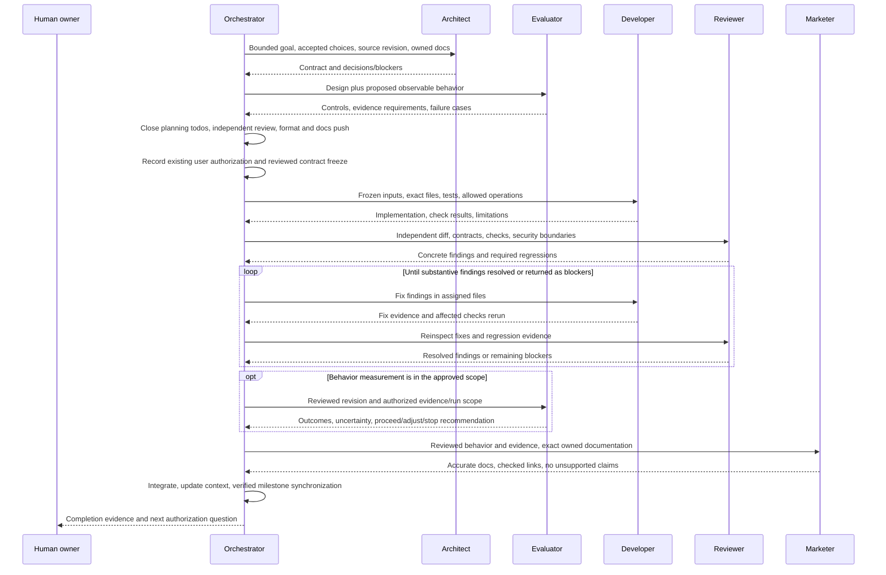
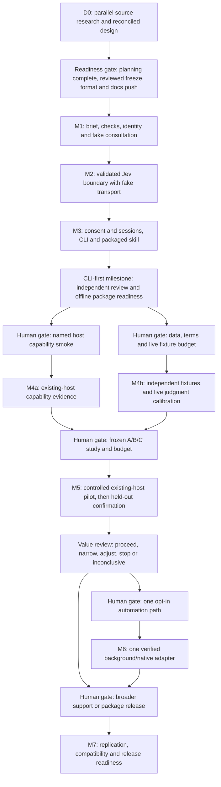

# Implementation plan: a CLI-first path to useful consultation

**Status: proposed, documentation only. Planning snapshot: 2026-10-11.**
This is a work sequence aligned to the canonical proposed v0 contract. Hunchcraft
currently has a TypeScript foundation, not a working
consultation CLI, Jev provider, shipped consultation skill, host adapter, background
service, or measured improvement. This update changes documentation only.

The latest user explicitly authorizes starting actual implementation after the
current todos and planning milestone are complete: reconcile the planning packet,
complete independent review/fixes and formatting, and synchronize the verified
documentation milestone through the orchestrator **before** starting offline M1–M3.
That authorization includes bounded source, dependency, test, and package work;
no redundant M1 source approval is required. Live host/main-model calls, Jev calls,
paid evaluations, dataset acquisition, automation expansion, and release/publication
remain separately gated. **No live or evaluation budget is approved.** This latest
instruction takes precedence over older authorization wording in nearby documents.

## 1. Purpose, authority, and document boundaries

The intended readers are the human project owner, orchestrator, and development
specialists. The useful takeaway is a dependency-ordered set of bounded work
packages: what to build, who hands it off, what evidence permits the next stage,
and when to stop rather than expand on an anecdote.

The confirmed direction is:

- Start with **portable CLI-first explicit consultation**, then consider opt-in,
  host-specific automation. No first host has been chosen by this plan.
- Preserve the **original request and selected actual source excerpts** for Jev,
  subject to **human-authorized, scoped session consent**. Possessing a key or
  installing a skill does not grant disclosure permission.
- Extend an unchanged coding host through supported surfaces; do not implement a
  custom coding-agent framework, replace its main model, or fork its runtime.
- Keep proposals, semantic judgments, deterministic checks, and action authority
  distinct. High-level roles are agreed; concrete algorithms, rubrics, operating
  thresholds, and protocol details are implementation proposals, not individual
  human-picked settings. The orchestrator and reviewer may select/freeze the bounded
  implementation defaults through coordinated contract review; changes outside the
  authorized scope or to human authority/data-sharing boundaries return to the user.

### Source of truth

| Document                                                                                                          | Owns                                                                         | How this plan uses it                                                                                              |
| ----------------------------------------------------------------------------------------------------------------- | ---------------------------------------------------------------------------- | ------------------------------------------------------------------------------------------------------------------ |
| [System design](system-design.md)                                                                                 | Canonical proposed CLI, schemas, policy, limits, and lifecycle               | Implement its approved revision; do not create competing flags, fields, exit codes, numeric caps, or defaults here |
| [Architecture](architecture.md) and [foundation ADR](decisions/0001-typescript-foundation.md)                     | Accepted layers, dependency direction, ESM/package/runtime boundaries        | Preserve these during every source slice                                                                           |
| [Existing-host ADR](decisions/0002-existing-agent-extension.md)                                                   | Supported-extension boundary                                                 | Reject a replacement model/tool loop, including one disguised as an evaluation runner                              |
| [Design discussion](design-discussion.md)                                                                         | Agreed responsibility split, hypotheses, coverage and feedback risks         | Turn risks into tests without presenting exploratory checks as accepted policy                                     |
| [Agent integration research](research/agent-integration.md)                                                       | Dated host/skills evidence and proposed integration obligations              | Inform host selection; source inspection is not runtime compatibility                                              |
| [Jev/CLI research](research/jev-cli.md)                                                                           | Dated provider, transport, credential, pricing/legal evidence and proposals  | Inform implementation review; recheck locked artifacts and account terms later                                     |
| [Evaluation plan](evaluation-plan.md)                                                                             | Proposed measurement protocol, controls, metrics, splits, and decision rules | Freeze approved experiment settings there, not in a second benchmark specification                                 |
| [Team guide](opencode-agents.md), [shared context](agent-context.md), and [contributor guide](../CONTRIBUTING.md) | Development roles, current status, and verification conventions              | Bootstrap and handoff requirements                                                                                 |

**Contract freeze:** [system-design.md](system-design.md) is available and was read
for this update, including its parser/compiler, provider, consent/storage, identity,
result, module-placement, and acceptance contracts. Record the latest user
authorization and independently reviewed contract revision at D0 exit. Architect-owned
review fixes to partial-output commit semantics and observable clock limits are
reconciled and independently rechecked. M1 grammar/compiler/identity are ready to
freeze under ADR 0003; the requirements below are regression obligations, not a
second schema. If documents disagree, return the conflict to the orchestrator rather
than silently adopting an earlier research sketch.

## 2. Authorization ladder: permission is not transitive

These gates are separate decisions. A reviewed design, a successful offline test,
and permission to publish documentation each have different meanings.

| Gate                                 | Required decision/evidence                                                                                                     | Does not authorize                                                                                             |
| ------------------------------------ | ------------------------------------------------------------------------------------------------------------------------------ | -------------------------------------------------------------------------------------------------------------- |
| **Planning completion — first**      | Reconciled docs, independent review/fixes, formatting and orchestrator's verified documentation push                           | Starting source work before current planning todos close; live calls, datasets or benchmarks                   |
| **Offline M1–M3 — authorized next**  | Latest user authorization recorded with reviewed contract revision, bounded work order, exact ownership and acceptance tests   | Live host/main-model/Jev calls, account validation, paid benchmarks, datasets, automation expansion or release |
| **Host capability execution**        | User approves a named host/version/executor, installation/provisioning if needed, sandbox operations, and smoke scope          | Jev disclosure, main-model/cloud spend beyond the approval, or compatibility with other versions               |
| **Live judgment execution**          | Authorized human approves session/provider/data scope, applicable terms, finite budgets, model/check versions, and exact study | Automatic disclosure, new repos/tasks, increased limits, background execution, or external sharing             |
| **Controlled end-to-end evaluation** | Approved frozen protocol, task rights, environments, independent grading, observability, budgets, and stopping rule            | Production benchmark features, official leaderboard claims for a modified protocol, or broad rollout           |
| **Automation expansion**             | Core value signal plus separate approval of one verified host path, authority, consent, lifecycle, and budgets                 | Universal background delivery, another host, or main-model rework                                              |
| **Distribution/release/outreach**    | Separate explicit approval for the relevant package release, npm publication, PR, or external post                             | Other publication actions or sharing raw/private artifacts                                                     |

The orchestrator alone integrates milestones, routes human decisions, updates shared
context, and handles the already authorized reviewed/verified documentation commits
and pushes. Specialists return their work; they do not commit, push, publish, or
recursively delegate in this plan. GitHub synchronization is not an npm release.

Offline M1–M3 authorization includes dependency installation/audit, local fake-provider
and fake-HTTP tests, emitted/packed-process tests, and package inspection after D0.
It is not permission for model requests or publishing the package. This documentation
handoff itself performs none of that runtime work.

## 3. Development team is not the runtime agent

The architect, evaluator, developer, reviewer, and marketer below are **development
roles contributing to Hunchcraft**. They are not a chain Hunchcraft invokes during
every user task. The runtime is still the selected existing coding host. It emits a
public proposal and deliberately consults the CLI; Jev returns typed judgments and
probabilities. Hunchcraft owns bounded execution and rendering, not a new agent loop.

A shipped consultation skill teaches that procedure. It neither launches a worker
nor grants shell/network access, credentials, or consent. Development-agent model
configuration is not an experimental baseline or a production model selection.
Configured reasoning-effort options are not measured reasoning telemetry.

### Substantial work-package chain

For each substantial behavior change, use:

**architect → evaluator for measurement design → developer → reviewer → developer
fixes → reviewer recheck → evaluator where behavior is measured → marketer for
accurate documentation → orchestrator integration and any user gate.**

Every arrow is a handoff coordinated by the orchestrator, not specialist recursion.
The first evaluator pass defines observables, falsification cases, and controls before
implementation. The later pass assesses evidence actually produced: offline
bookkeeping for early stages, semantic or end-to-end outcomes only when approved.
It must not turn fake-provider success into a Jev accuracy claim.

Do not invoke every specialist for every small edit. A fix under a frozen contract
normally needs developer → reviewer, with evaluator only if measurement semantics
changed. A docs-only clarification normally needs marketer → technical review where
necessary. Reuse accepted architect/evaluator inputs across adjacent slices. A new
boundary, authority rule, or measurement change reopens the relevant specialist gate.



The review loop is substantive: resolve correctness/security/race findings, add
regressions where needed, rerun affected checks, and re-review. “Reviewer invoked”
without findings disposition and evidence is not an acceptance gate.

## 4. Dependency DAG and milestone shape

M1–M3 form one **CLI-first offline milestone**, delivered as small working slices.
Avoid a long sequence of abstract interfaces with no demonstrable consultation
path. Each slice must exercise a bounded path through a fake provider or the
approved injected transport. Fake results remain visibly synthetic and never become
a production success fallback. No month estimates or invented delivery dates are
needed: completion depends on evidence and approvals.



Arrows show readiness dependencies, not authorization. M4a and M4b can proceed
independently only after their respective approvals; they must not share mutable
fixtures or silently spend each other's budgets. M5 pilot and confirmation have
separate freezes and execution approvals. M6 is optional: foreground value does not
prove useful overlap. M7 release can omit background support entirely.

## 5. Stage D0 — research, design reconciliation, and approval

**Current scope:** planning documentation and read-only research. No runtime work.

**Inputs:** bootstrap documents, the two research reports, evaluation proposal,
canonical system design, accepted ADRs, and the latest user direction.

**Work packages and agent chain:**

1. Orchestrator assigns disjoint research questions in parallel: host observation/
   await/delivery; Jev SDK/API/transport/privacy; and evaluation literature/controls.
   This is research parallelism, not permission for installs or live requests.
   Each return records access date, version/revision, source conflicts, gaps, and
   whether evidence is documentation, code inspection, metadata, or measurement.
2. Architect consolidates the canonical proposal and decision list. Evaluator checks
   whether proposed signals, failure states, and accounting support the planned
   controls and omission tests. Developer may review implementability/types as
   research, not implement. Reviewer independently checks technical consistency.
3. Architect resolves review findings through the orchestrator; evaluator rechecks
   changed measurement assumptions. Marketer aligns implementation-stage wording
   and evidence labels without owning the system protocol.
4. Orchestrator closes current planning todos, integrates independent review/fixes,
   verifies formatting, and pushes the reviewed documentation milestone. Record the
   latest user's existing M1–M3 authorization plus exact reviewed contract revision,
   implementation defaults and ownership before assigning source work. Do not ask
   again for permission to start M1 within that scope; escalate genuine scope changes.

**Deliverables:** reconciled design/implementation/evaluation documents; source and
conflict register; concrete accepted-versus-proposed decision list; future file
ownership; and a no-runtime-work verification record. Significant newly accepted
protocol/security choices get an ADR through a separately assigned owner.

**Exit gate:**

- Canonical schema/CLI/lifecycle responsibilities and finite limits are reviewable;
  illustrative research JSON/commands cannot accidentally become another contract.
- Baseline request-to-whole-proposal coverage has a route independent of optional
  proposer checks. Unknown-domain coverage is described honestly, not guaranteed.
- Human session consent design is settled sufficiently for implementation: grant,
  scope, expiry/revocation, provider, selected data, and allowed work. Consent cannot
  be broadened by source instructions or an agent's self-assertion in cooperating
  use. TTY confirmation is not protection against malicious same-user code.
- Budget enforcement distinguishes local request/attempt bounds from an absolute
  provider dollar/token cap. Unverifiable hard-cap requirements remain blockers to
  live execution, not advisory defaults advertised as guarantees.
- Independent technical review/fixes, documentation formatting and orchestrator
  milestone push complete; existing user authorization and reviewed default-policy
  revision are recorded. Unresolved live/account questions remain blocked without
  preventing offline implementation. Numeric defaults are reviewed implementation
  choices, not approved paid budgets or settings individually selected by the human.

## 6. Stage M1 — offline core and one fake-provider consultation

**Goal:** make the approved artifact travel through a real bounded use case, with
synthetic answers, before adding network or host machinery.

**Dependencies:** completed D0 and the already supplied M1–M3 authorization. No real
key, concrete TypeSafe construction, host launch, or semantic evaluation.

**Chain:** architect freezes the narrow core/port/application contract → evaluator
defines fixture expectations and accounting assertions → developer implements each
slice → reviewer inspects → developer fixes and adds regressions → reviewer rechecks
→ evaluator inspects offline evidence → marketer documents the synthetic workflow.

**Reviewed slices:**

1. **M1a — pure validate/compile/represent:** strict fatal UTF-8 decoding and bounded,
   decoded-key duplicate-aware parsing (escaped equivalents are duplicates), brief
   shape/reference/quote/provenance validation, the full mandatory check compiler,
   and pure canonical identity representation. Reject BOM, invalid surrogates,
   unknown fields, overflow and malformed input under system-design sections 6–9.
   No Node crypto in core: preserve deterministic serialization separately and inject
   hash computation later. Add meaningful Vitest cases and remove `passWithNoTests`
   in this first slice, not at the end of the milestone.
2. **M1b — internal fake consultation/verify:** add only concrete ports needed by
   the application, with in-memory consent and injected hash/clock/fake provider.
   Test terminal precedence, final checks, deadline/cancellation, immutable binding,
   verification and race/lifecycle behavior. This is internal test injection, not a
   production fake-provider flag, consent bypass, or fabricated TypeSafe live metadata.
   No worker, supervisor, queue framework or agent launcher.

The reviewed v0 scope is **1–3 components**, mandatory `component-outline.v0`
checks in canonical order, and the canonical **16-check** maximum. The expansion
formula is `2 + requirements + 4 × components + relationships + localQuestions`;
outer entity bounds do not guarantee a combination fits. Both whole-proposal
request/domain checks remain even with zero extracted requirements and zero local
questions. Reject overflow without dropping coverage. Score criteria are the
canonical three levels **0–2**, not approval percentages. V0 uses Noul and Score;
general-purpose Choice/candidate selection is outside this slice. All raw signals
and static feedback remain visible in order, without production filters/thresholds.
These restate the canonical implementation policy; do not independently change its
literal templates, schema, flags or numerical bounds here.

**Meaningful offline acceptance cases:**

- Original request survives validation and provider translation; a proposer summary
  cannot replace it. Selected excerpts are actual content, not only paths/hashes.
- A synthetic omitted-outcome case still receives the approved baseline coverage
  check when optional checks are empty. This proves the route exists, not that Jev
  detects omissions or implicit obligations.
- Necessary tests, compatibility handling, and lifecycle cleanup are not deleted,
  hidden, or “approved away” by a fake adverse result. Signals grant no action rights.
- Source contradiction, missing evidence, uncertainty, and unavailable assistance
  remain distinguishable. Preference scores cannot erase required-outcome signals.
- Deferred promises/fake clocks cover rejection, deadline, abort, late completion,
  identity changes between completion and use, overlapping sessions, and disposal
  for the resources this slice actually owns. Do not add a queue framework merely
  to test future background cases.
- No unhandled rejections, credential access or work on import, hidden network, or
  synthetic “passed” judgment on error. Default tests require no credentials.

**Exit:** a working fake-provider consultation with regression evidence;
`passWithNoTests` removed when the first behavior test lands; `npm run check`
passes after source/tooling changes. Evaluator confirms bookkeeping evidence only;
docs still say semantic usefulness is unmeasured. Any test/config edit has its own
explicit file owner, including the temporary empty-suite setting.

## 7. Stage M2 — Jev provider boundary, entirely offline

**Goal:** implement the approved provider translation and safe transport without
sending a live request. Library types alone are not external-data validation.

**Dependencies:** reviewed M1 contracts; offline dependency operations are authorized
after D0. Check
the actual installed, locked SDK artifact/declarations before relying on research
signatures. Preserve TypeScript 6.0.3 unless an independently justified upgrade is
approved; keep SDK types outside core/ports/application.

**Chain:** architect confirms transport and policy placement → evaluator specifies
attempt/usage/error observables → developer implements → reviewer independently
checks the security boundary → developer fixes → reviewer rechecks → evaluator
validates offline counters → marketer explains the provider's untested live status.

**Reviewed slices:**

1. **Translate through injected fake transport:** construct only the approved
   allowlisted provider state/questions. Keep consent, keys, local session records,
   and unrelated metadata out of outbound state. Verify original request and selected
   content reach the fake transport intact.
2. **Validate responses:** primitive-specific structure, exact answer routing, model
   identity, finite values/distributions, canonical Score 0–2 level/legend consistency, bounded body
   reads, and usage validation according to the canonical spec. Cover malformed,
   missing/extra, oversized/chunked, and unexpected-model replies. Do not silently
   normalize invalid probabilities or accept a cast as validation.
3. **Enforce failure/security policy:** whole-operation deadline across transport
   with the canonical zero-retry policy, local abort, late-answer suppression, sanitized
   diagnostics, approved endpoint/redirect behavior, controlled SDK logging and
   configuration precedence. No arbitrary inherited override may redirect secrets.

**Acceptance:** fake responses for the supported primitives and documented error
categories; bounded transport/body failure; secret-bearing error/headers/source
never echoed; environment poisoning/logging cases; no layered hidden retries; every
attempt counted, including failed/unknown-usage attempts. Usage and prices remain
unknown where unavailable, not zero. Cancellation does not claim remote billing
stopped. Inert import tests and explicit initialization/disposal evidence remain.

**Exit:** independent boundary review, regressions, `npm run check`, synchronized
lockfile for dependency changes, and package inspection if payload/exports change.
The report states **offline provider contract implemented; live service behavior
not verified**. No authenticated model listing or key validation is part of M2.

Use the pinned candidate SDK only after the installed-artifact/type audit; exercise
its capped transport through fake HTTP, including strict raw response parsing before
SDK parsing. Local-state storage need not precede this isolated fake-HTTP work, but
its M3 secure admission/root-identity tests **must precede production TypeSafe wiring**.

## 8. Stage M3 — consent/session admission, minimal CLI, and shipped skill

**Goal:** complete the first usable offline CLI milestone: an authorized artifact
can be validated and consulted through a working fake path; live admission remains
blocked until separately approved. Do not ship a fake result as a live fallback.

**Dependencies:** reviewed M1/M2 behavior and reconciled canonical CLI/session design.
Exact commands, flags, envelopes, paths, configuration precedence, limits, and exit
codes come from that specification. This plan deliberately gives none of its own.

**Chain:** architect confirms human-consent and executable boundaries → evaluator
defines admission/accounting and process observables → developer implements bounded
slices → reviewer checks security/platform/package behavior → developer fixes →
reviewer rechecks → evaluator audits offline evidence → marketer writes tested
onboarding/help/consultation guidance against the actual implemented commands.

**Reviewed slices:**

1. **Human-scoped session admission:** implement the approved human grant path,
   scope matching, expiry/revocation, attempt reservation, and fail-closed behavior.
   A key, repository file, copied result, resumed host, or agent assertion must not
   silently create or broaden consent through supported cooperating commands.
   TTY confirmation/session handles do not authenticate a hostile same-user agent.
   Keep grant material out of Jev payloads; v0 binds the local scope, real Git worktree
   root/opened platform file identity and cwd, not an authenticated native host session.
2. **Shared state and budgets:** test canonical persistence/admission behavior,
   including concurrent CLI processes, lock contention, crash recovery, atomic
   updates, unknown charged attempts, and permission failures. Windows ACLs and
   junctions require explicit handling; Unix mode bits do not prove Windows privacy.
   Random filenames are not the access boundary. Same-user hostile processes remain
   a stated threat-model limit, not solved by a session file.
   Implement `providers/local-state` before production provider wiring: platform state
   roots from the canonical spec, one active reservation/session, zero waiting queue,
   permanent consumed admissions, duplicate rejection, UUID-owned release, revocation
   marker and crash-blocked slot with human revoke/new-session recovery. No lease
   stealing, count refund, stale-PID kill or automatic replay.
   Start with a bounded offline Windows feasibility spike for current-user ACLs,
   junction rejection, opened root file identity and atomic replacement. A fixed
   .NET/PowerShell helper is a proposed mechanism owned by the architect for review,
   not an accepted shell-string API or claim Windows works. Use fixed operations and
   bounded safe data exchange; reject unsupported secure storage/file identity
   rather than weaken the contract. Test actual platforms before support claims.
3. **Input/output and process path:** bounded approved input parsing, finite EOF/wait,
   stdout/stderr separation, external values validated as unknown, cancellation,
   backpressure/EPIPE and partial-output behavior. Test emitted ESM executable paths
   with spaces/Unicode/CRLF and platform-specific launch constraints. No shell-string
   interpolation of request/source/key material.
   Required process regressions include failure before any output, backpressure,
   blocked pipes, EPIPE, cancellation/deadline before and during write, partial bytes
   emitted then failure, and crash between local commit and flush. Follow the
   architect's reconciled output-commit policy: **do not append a replacement error
   envelope after a partially emitted judgment**; delivery is unknown, the admission
   remains consumed, and best-effort local terminalization records `delivery-unknown`
   where specified. Callers wait for process close and reject incomplete/unvalidated
   output. A completed local commit or successful write callback is not consumption.
   Test observable monotonic elapsed limits and wall-clock rollback/skew checkpoints
   across verify; acknowledge unobservable cross-process clock changes and machine
   clock trust. Do not claim clocks or partial output can be atomically controlled.
4. **Offline help/configuration and packaging:** explicit startup only; no provider
   activation, credential-value disclosure, DNS/model listing, auto-installation,
   hooks, or repo scanning from help/import/local validation. Diagnostic credential
   presence is not credential validity and follows the canonical permission boundary.
   Human provisioning of `TYPESAFE_API_KEY` is separate from host authentication and
   session consent. No keys in argv, copied skill content, fixtures, or logs.
5. **Portable consultation skill:** a short version-matched procedure and resources;
   original request/evidence preparation, advisory interpretation, unavailable
   fallback, consumption-time freshness check, and when not to consult. Distinguish
   executable install, skill install/discovery, manual-read fallback, and opt-in host
   automation. No model override, background promise, or universal slash syntax.
   Use canonical `skills/hunchcraft-consult/SKILL.md` and version-matched references:
   executable provisioning and instruction installation are **two separate steps**.
   Local package tests/install instructions do not imply npm publication.

**Acceptance:** human grant required before provider admission; denied/out-of-scope/
expired/revoked sessions call no provider; parallel admission cannot exceed the
approved enforceable local bound; state/log permissions fail safely; fake network
captures contain only authorized selected material. Output preserves exact bindings
without action permission or fabricated explanation. One-shot results honestly
require a host/consumer freshness comparison after return; the CLI cannot observe
future host edits or enforce model compliance by claiming a result is forever fresh.

**Verification:** `npm run check`; `npm pack --dry-run` for new bin/exports/payload;
inspect actual compiled entry points, declarations, executable resolution and skill
resources. Under the existing offline M1–M3 authorization, test the real packed artifact in controlled
temporary Windows/Linux setups without publishing. Record observed matrix cells;
configured Node 22/24 Windows/Linux CI is not proof remote runs completed. Preserve
the accepted runtime/development Node distinction and synchronized npm lockfile.

**Exit:** independent review of the complete fake consultation path and package;
docs can describe tested offline behavior only. No npm publication, host support
claim, live Jev success, or strict-dollar-cap promise follows from packaging checks.
If an absolute spend ceiling is required but cannot be enforced using verified
account/estimation mechanisms, retain the live-admission blocker.

## 9. Stage M4 — separately approved host smoke and judgment feasibility

M4 contains two independently gated packages, not one blanket authorization.

### M4a: verify one chosen existing-host consultation path

**Inputs:** CLI-first milestone; source-backed candidate matrix; a human choice of
host/version/executor; explicit provisioning/execution approval and limits. Select
based on the deployment and supported contracts, not developer familiarity or an
installer's compatibility table. No host is hardcoded here.

**Chain:** architect defines a minimal capability proof → evaluator specifies
observable checkpoints/usage limits → developer implements only approved smoke
fixtures or a thin external wrapper → reviewer checks unchanged-host boundary →
developer fixes → reviewer rechecks → evaluator records observations → marketer
publishes a narrowly worded local compatibility note, not an outreach post.

Verify shell/file/stdin availability, executable provisioning in the actual executor,
ordinary tool-result delivery, output truncation, instruction discovery/manual read,
permission denial, cleanup, original-request preservation, and freshness instructions.
Start with the fake provider where permitted. A host smoke can incur main-model
spend even with no Jev calls; it needs its own budget. No automatic hook installation
or sandbox bypass. Record installed version, OS/mode, commands, observed timing,
public artifacts, and limitations. A UI notification is not model consumption.

**Exit:** a reproducible foreground consultation opportunity on that exact setup,
clean resets, finite failure behavior, and an inventory of actually exposed usage/
timing/patch data. Missing total-cost observability blocks a total-dollar-savings
study or requires a narrower approved claim. No private chain-of-thought is requested
or inferred. A smoke is compatibility evidence, not value evidence.

### M4b: frozen fixtures and approved live rubric calibration

**Inputs:** offline boundary tests; independent fixture/label design from the
evaluation plan; authorized data/account owner; verified applicable terms/rights,
retention/region disclosures, budget policy, model/check versions, and separate
execution approval. Research price snapshots are not approved current billing.

**Chain:** architect confirms approved check bindings/coverage → evaluator freezes
fixture protocol and independent issue labels → developer implements only assigned
offline fixture validation and separate evaluation plumbing → reviewer checks
leakage/privacy/accounting → developer fixes → reviewer rechecks → evaluator runs
only the approved study and reports → marketer documents measured limits accurately.

Cases include valid minimal plans, omitted original-request outcomes with no optional
question naming them, source contradiction versus missing evidence, necessary tests/
support, relationship mismatches, explicit unknowns, and unfamiliar-domain limits.
Labels precede model answers and selected questions; issues with no applicable check
count as coverage misses. Do not use Jev as its own grader. Keep tuning/dev and
held-out cases separate; counts and thresholds come from the approved evaluation
protocol, not this stage heading. Any fitted thresholds are dev-only analytical
settings unless a separately reviewed future policy change is authorized; v0
production continues rendering all raw signals without numeric filtering.

**Exit:** independent quality/coverage/calibration and false-alarm results, complete
attempt/unknown-cost accounting, reviewed failure analysis, and justified analytical
settings fitted only on dev without adding production thresholds. If omissions remain invisible or necessary support is
repeatedly discouraged, narrow/revise/stop. No confirmatory claim on tuned fixtures.
Harmful/adversarial live probes require an additional provider-policy check and
explicit approval; offline coverage is not permission to send them.

## 10. Stage M5 — controlled existing-host A/B/C value evaluation

**Goal:** distinguish scaffold overhead/benefit from the Jev-assisted workflow's
whole-task effect. Successful typed output alone is not implementation improvement.

**Dependencies:** M4a and M4b readiness; approved protocol, data licenses and hidden
grading boundary; finite aggregate budgets; controlled environments; human-selected
business tolerances and stopping rules. An exploratory pilot precedes separately
approved held-out confirmation. Pilot observations inform precision/budget planning,
not retrospective confirmatory thresholds.

**Chain:** architect reviews host-preserving evaluation placement → evaluator freezes
controls/metrics/analysis → developer implements separate trial plumbing and offline
accounting tests → reviewer checks controls and leakage → developer fixes → reviewer
rechecks → evaluator executes only approved trials and analyzes → marketer prepares
evidence-linked results/limitations → orchestrator routes proceed/adjust/stop decision.

The developer does **not** add a benchmark harness to the production CLI or implement
a custom proposal/model/tool loop. Evaluation infrastructure may reset sandboxes,
invoke a supported existing-host CLI, provision the declared treatment, collect
public artifacts, export patches, call an unchanged grader, and aggregate records.
Keep it outside production exports/payload. Identical external wrappers across arms
must not secretly change the host's normal model or fundamental workflow.

**Required contrasts from the evaluation plan:**

- **A:** unchanged unassisted host/model/task instructions.
- **B:** matched brief/evidence/check/continuation scaffolding, no Jev advice and no
  fabricated positive result.
- **C:** same scaffolding plus approved pinned Jev judgments and advisory feedback.

Freeze task/repo revisions, arm setup, evidence exposure policy, versions, budgets,
resources, cache/reset policy, randomization, exclusions, retry rules and hidden
grading before execution. No free extra overall budget for C. Count all attempts,
failed/unused/late work, proposal preparation, retrieval, consumption, repairs,
helper/main-model/Jev usage and charges, and initialization/disposal. Missing costs
are unknown; successful-only means cannot establish whole-loop savings.

Run the dev pilot first. For confirmation use an untouched product-relevant subset
and a separately governed established external subset as proposed in the evaluation
plan. Pin dataset release, selected task licenses, resources and verifier. The external
subset is not automatically a TypeScript product proxy. Approved Jev network
exceptions or wrapper changes must be disclosed as a controlled variant, not an
official comparable leaderboard protocol. Keep raw corpora outside the npm package.

Hidden tests, reference solutions, future history and prior traces remain grader-side
and out of both main-model and Jev evidence. Capture all assigned outcomes, including
partial patches and exhausted budgets; re-grade pristine sandboxes. Independent
semantic grading remains distinct from official test resolution, with imperfect
blinding disclosed. Necessary tests/components cannot be automatically removed or
actions approved by provider signals.

**Exit:** reproducible reviewed artifact index; paired C−A and C−B outcomes with
uncertainty and all-trial denominators; quality/harm/latency guards; budget and missing
data audit; negative results and scope limits. Business margins and statistical rules
must be set before confirmation, not invented here. Outcome options are **proceed,
narrow, adjust, stop, or inconclusive**. Scaffolding-only gains are not Jev gains;
foreground gains are not asynchronous gains; shorter prose is not compute evidence.
Publication of results or artifacts requires its own authorization and rights check.

## 11. Stage M6 — optional background/native automation on one verified host

**Goal:** test whether bounded overlap adds value after the core consultation signal
is credible. This is not a prerequisite for shipping foreground consultation.

**Dependencies:** M5 core value signal or a separately justified human-reviewed
value criterion; explicit automation approval; one chosen host/version with verified
observation/await/delivery; approved consent, work/spend bounds, and actual runtime
ownership. Source evidence alone cannot establish this gate.

**Chain:** architect chooses the minimal supported mechanism and freshness checkpoint
→ evaluator designs same-policy timing controls/waste metrics → developer implements
bounded slices → reviewer inspects races/lifecycle/security → developer fixes →
reviewer rechecks → evaluator measures approved behavior → marketer documents only
the verified host/version/mode and observed effects.

Do not build a general daemon, universal hook bus, or every researched adapter.
Choose one native route or one explicitly owned cooperative retrieval route. Reuse
core/provider semantics; keep host SDK/envelopes at the integration boundary and
concrete wiring in composition. No sibling adapter imports or private reasoning.

**Offline-before-live slices and gates:**

1. **Observe/admit:** a stable public artifact and original-request provenance;
   exclude own results/submissions, handle duplicates/gaps, enforce finite
   cross-process admission. A host's execution semaphore is not a queue/spend cap.
2. **Own work:** readiness before acceptance; explicit start/dispose; whole deadline
   including queue wait; approved saturation/supersession; crash/expiry recovery;
   cancel and handle every rejection; no blind replay of possibly charged requests.
3. **Deliver/consume:** documented model-visible checkpoint, current source/session
   match at use, reversed completions, changed request/proposal/evidence, and explicit
   residual race if the host cannot enforce consumption-time freshness. Stored,
   queued, delivered, consumed, and useful are different observations.
4. **Isolate/stop:** same-worktree concurrent sessions, fork/resume policy,
   ACL/IPC/storage boundaries where needed, reload, owner disconnect, abrupt exit,
   ignoring-abort provider, bounded outstanding work, cleanup and no late delivery.

Run offline replay with the same recorded judgment to isolate timing mechanics;
that is not fresh semantic evidence or live latency. Only after independent review
and separate execution approval compare foreground and background with matched
checks/evidence/policy. Measure timely fresh uptake, host blocked intervals, extra
polls/turns/wakes, stale/unused/failed spend, outcomes, and whole-task time/cost.

**Exit:** actual support for one tested host/version/mode; lifecycle/race regressions;
`npm run check` and affected package checks; measured timing value within approved
guards or a restriction/stop decision. No “works automatically everywhere” claim,
no wake-on-every-result by default, and no inferred mid-generation injection.

## 12. Stage M7 — broader settings, distribution, and optional release

**Dependencies:** independent replication need, compatibility evidence, and separate
approval for each new host/model/mode or release action. M6 is optional.

**Chain:** architect assesses the concrete new boundary → evaluator defines replication
and compatibility evidence → developer implements one extension/packaging slice →
reviewer checks → developer fixes → reviewer rechecks → evaluator assesses approved
results → marketer updates onboarding, tested support matrix and release notes →
orchestrator obtains and performs only authorized publication actions.

Keep broader host work serial where it touches shared application/provider contracts.
Use separate version targets and test fixtures; do not pool changed models/hosts as
one original treatment. Revisit abstractions only for demonstrated needs. No multiple
packages, MCP layer, credential broker, installer framework, or CommonJS build solely
because a roadmap might need it.

**Release readiness:** actual packed-artifact tests, public export/payload review,
installed-version skill resources, lockfile/license notices, non-secret configuration,
privacy/retention guidance, tested install/runtime instructions, and accurate lifecycle/
failure docs. Run `npm run check`, `npm pack --dry-run`, and documentation checks as
applicable. Verify remote CI outcomes separately. Draft changelog/release notes only
for real release work; do not invent an adoption story or benchmark win.

No automatic npm publication, release, PR, artifact upload, or external campaign
follows from this plan. Marketing drafts stay local until explicitly approved.

## 13. Future file ownership and concurrency rules

Paths below are **illustrative planning ownership**, not files to create now or a
duplicate module/API design. The architect adjusts them to the canonical spec;
the orchestrator replaces each area with exact filenames before issuing a work
order. Keep cohesive modules; no interface-per-class boilerplate or generic service
framework. Layer dependencies remain inward and explicit.

| Work area                           | Illustrative future paths                                                                                                                     | Owner and serialization boundary                                                                                                                   |
| ----------------------------------- | --------------------------------------------------------------------------------------------------------------------------------------------- | -------------------------------------------------------------------------------------------------------------------------------------------------- |
| Core artifact, checks, identity     | `src/core/brief.ts`, `src/core/checks.ts`, `src/core/identity.ts`, `src/core/result.ts`                                                       | Developer; M1a owns pure validation/compiler/representation; serialize shared contracts before consumers                                           |
| Concrete provider port              | `src/ports/decision-provider.ts`                                                                                                              | Developer under architect-approved contract; freeze before provider/application parallel work                                                      |
| Consultation/verification use cases | `src/application/consult.ts`, `src/application/verify.ts`, `src/ports/clock.ts`                                                               | M1b owner; injected in-memory consent/hash/clock/provider before concrete I/O                                                                      |
| Jev boundary                        | `src/providers/typesafe/provider.ts`, `src/providers/typesafe/transport.ts`                                                                   | M2 owner; locked SDK audit and fake HTTP, no concrete production admission wiring yet                                                              |
| CLI boundary and wiring             | `src/integrations/cli/arguments.ts`, `input.ts`, `output.ts`, `run.ts`; `src/composition/cli.ts`, `create-cli.ts`                             | M3 owner; exact filenames assigned, shared wiring serialized after secure storage readiness                                                        |
| Consent/session state               | `src/core/consent.ts`, `src/ports/session-consent.ts`, `src/providers/local-state/session-store.ts`; architect-selected platform helper files | M1b pure/port then M3 concrete owner; Windows feasibility spike and secure root identity before production wiring                                  |
| Behavior and contract tests         | Exact files under `tests/core/`, `tests/application/`, `tests/providers/`, `tests/cli/`, `tests/contracts/`                                   | M1a owns first meaningful tests and empty-suite removal; disjoint files and serialized shared helpers                                              |
| Tooling/package/public API          | `vitest.config.ts`, `package.json`, `package-lock.json`, `src/index.ts`, `scripts/check-package.mjs`, relevant CI config                      | One developer owner at a time; first behavior slice explicitly owns empty-suite removal; exports/config changes serialized                         |
| Shipped consultation skill          | `skills/hunchcraft-consult/SKILL.md`, `skills/hunchcraft-consult/references/usage.md`                                                         | Marketer owns assigned guidance against frozen implemented commands; developer owns package payload, separate executable/instruction install steps |
| One selected host adapter           | `src/integrations/<selected-host>/` and exact matching test files                                                                             | Separate future slice; no other host files or shared source changes without reallocation                                                           |
| Evaluation plumbing/artifacts       | Separate approved evaluation scripts/tests and governed artifact locations                                                                    | Developer implements assigned plumbing; evaluator owns protocol/labels/analysis; not production exports or npm corpora                             |
| Nearby documentation/ADRs           | Explicit named docs per work order                                                                                                            | Architect for canonical spec/ADRs, evaluator for measurement docs, marketer for onboarding/results; shared context orchestrator-owned              |

Parallel research is encouraged. Parallel source work starts only after stable
contracts and disjoint actual files are assigned. Directory labels do not override
a conflicting filename assignment. If a package needs another owner's file, return
to the orchestrator; serialize the change or reassign ownership rather than editing
it opportunistically. Reviewer independently inspects and reports; developer fixes.

## 14. Bootstrap, handoff template, and minimal work order

### Bootstrap for every substantial package

1. Read [AGENTS.md](../AGENTS.md), [shared context](agent-context.md),
   [README](../README.md), [architecture](architecture.md),
   [CONTRIBUTING](../CONTRIBUTING.md), relevant layer README and accepted ADRs.
2. Read the approved canonical design revision, this plan, relevant research and
   evaluator protocol. Load architecture/TypeSafe/async/TypeScript skills when
   applicable; current SDK/host docs and installed types supersede stale examples.
3. Inspect worktree status and assigned inputs. Preserve concurrent work. Confirm
   exact ownership, authorization, expected outputs, and checks before editing.
4. If a contract, factual claim, permission, or boundary is unclear, return a blocker
   or decision request to the orchestrator. Do not recurse to another specialist.

### Work-order and return template

```text
Goal and observable user behavior:
Stage and bounded slice:
Accepted decisions / approval reference:
Canonical design + source revisions:
Inputs, provenance, and explicit unknowns:
Owned exact filenames; read-only dependencies; prohibited files:
Allowed operations; implementation vs host/live/publication gates:
Deliverables and non-goals:
Acceptance cases, including failure/privacy/freshness/accounting:
Checks required and environments actually available:
Expected return: changed files, check command/outcome, evidence links,
findings disposition, limitations, blockers, and next decision:
No secrets, private source, hidden tests, or raw auth/error dumps in return:
```

**Minimal sample — M1a validate/compile/represent work order after D0:**

> Goal: strict parsing/validation retains original request and selected excerpt text,
> compiles every canonical check without optional-proposer veto, and constructs pure
> canonical identity representation. Inputs: recorded latest user implementation
> authorization, completed D0 freeze and reusable evaluator synthetic-case criteria.
> Planned owned files, confirmed before assignment: `src/core/brief.ts`,
> `src/core/checks.ts`, `src/core/identity.ts`, exact parser/core test files and
> `vitest.config.ts` for first meaningful tests/empty-suite removal. A parser boundary
> filename, if required, is architect-approved and explicitly assigned rather than
> hidden in core or opportunistically added. No Node crypto in core, provider/consent
> I/O, SDK, host launch, network, package metadata or other documentation edits.
> Regressions: fatal UTF-8, escaped duplicate keys, strict refs/quotes, preserved
> CRLF/Unicode text, zero-requirement global checks, full literal order/binding,
> 16-check overflow rejection without truncation, and canonical object-key versus
> array/text order semantics. Run `npm run check` after implementation; return exact
> files, actual commands/outcomes and blockers. M1b separately adds the fake-provider
> lifecycle path. No new user approval is needed for M1a within the authorized scope.

This is an example handoff, not an assignment or acceptance of those filenames.

## 15. Phase readiness checklist

All entries describe **future exit evidence**. No runtime row is complete because
this document exists. Record actual evidence and approval references at handoff;
do not pre-check gates using configured CI or plans for tests.

| Phase | Required readiness evidence                                                                                                                                                   | Stop/return condition                                                                                            |
| ----- | ----------------------------------------------------------------------------------------------------------------------------------------------------------------------------- | ---------------------------------------------------------------------------------------------------------------- |
| D0    | Canonical spec/review fixes aligned; current planning todos closed; independent review, formatting and docs push; existing user authorization plus reviewed revision recorded | Unresolved contract/output/clock issue needed by the slice, not absence of a redundant M1 approval               |
| M1    | Working fake path; omission-route and identity regressions; empty-suite allowance removed; check passes                                                                       | Original request lost, optional-only coverage, synthetic approval fallback, unsafe result use                    |
| M2    | Locked SDK artifact reviewed; fake-transport validation/security/deadline/attempt tests; check and relevant package inspection                                                | Unbounded body/retry, secret leak, SDK casts replacing validation, unknown usage counted as zero                 |
| M3    | Human session admission and concurrent-state tests; bounded emitted CLI; inert help/import; packaged skill resources; independent platform/package review                     | Agent self-grants consent, shared-state/ACL failure, misleading hard cap, raw logs, default live dependency      |
| M4a   | Separate named-host approval and observed foreground route/reset/usage evidence                                                                                               | Unsupported delivery, host rewrite required, sandbox bypass, unobservable required metric                        |
| M4b   | Separate live/data/account approval; independent frozen labels; quality/coverage/calibration report                                                                           | Invisible omissions, harmful support-work advice, terms/data rights unclear, budget not enforceable as required  |
| M5    | Approved pilot then frozen confirmation; A/B/C controls; pristine hidden grading; all-cost paired analysis                                                                    | Leakage, changed treatment, missing primary margins/costs, harmful or inconclusive outcomes disguised as success |
| M6    | Separate one-host automation approval; offline lifecycle tests then approved timing evidence                                                                                  | No timely fresh consumption, unbounded cross-process work, extra wakes/waste erase value                         |
| M7    | Replication/support evidence; package/install/privacy/license/CI audit; separate release/publication approval                                                                 | Unsupported compatibility/generalization, private artifact payload, absent publication permission                |

Common completion checklist:

- [ ] Goal, accepted decisions, exact files, and permissions are recorded.
- [ ] Behavior has meaningful offline regression tests before live execution.
- [ ] Independent findings are fixed/rechecked or returned as explicit blockers.
- [ ] `npm run check` ran after source/runtime configuration/tooling changes.
- [ ] `npm run format:check` ran for documentation changes; paths/instructions checked.
- [ ] `npm pack --dry-run` was inspected for package/bin/export/payload changes; real
      packed-artifact execution is separately recorded when permitted.
- [ ] Dependency changes include synchronized `package-lock.json` and artifact review.
- [ ] Observed local/platform/remote CI evidence is distinguished from configured tests.
- [ ] No secret, private evidence, hidden grading material, or unauthorized artifact
      entered logs, public reports, commits, or package payload.
- [ ] Evaluator/marketer distinguish fake contracts, live semantics, host support,
      measured task value, and untested roadmap claims.
- [ ] Orchestrator owns integration, shared context, human decisions, and authorized
      milestone synchronization; next-stage execution is not assumed.

## 16. Risk and dependency log

This is a planning log, not a claim that a safeguard is implemented. Specialists
supply evidence; the orchestrator resolves bounded implementation choices through
review and routes human authority/scope/live-budget decisions to the user.

| Risk/dependency                                                                       | Owning handoff                               | Evidence/gate needed                                                                             | Response if unresolved                                                                |
| ------------------------------------------------------------------------------------- | -------------------------------------------- | ------------------------------------------------------------------------------------------------ | ------------------------------------------------------------------------------------- |
| Canonical review fixes can differ from research sketches                              | Architect → orchestrator                     | Reconciled output/clock policy, reviewed revision and existing user authorization before D0 exit | Resolve needed contract ambiguity; no duplicate protocol or redundant M1 approval     |
| Baseline checks inherit omissions; implicit obligations/unknown domains lack coverage | Architect + evaluator                        | Original-request route, independent issue inventory, missing-check denominator, held-out cases   | Narrow scope or report limitation; no completeness certificate                        |
| Positive/cleanliness signal acquires action authority                                 | Architect + reviewer                         | Advisory policy, preserved requirements/tests, no automatic pruning/approval                     | Stop and fix before host/live use                                                     |
| Consent forged/broadened by agent, repo text, fork/resume, or copied artifacts        | Architect + developer + reviewer             | Human-scoped grant and scope/revocation/isolation tests                                          | Deny admission; route ambiguous ownership to human                                    |
| Windows ACL/junction behavior or shared user state undermines privacy                 | Developer + reviewer                         | Actual Windows/Linux permission, containment, failure and concurrency tests                      | Fail safely; do not claim same-user hostile-process isolation                         |
| Cross-process locking/reservations race, crash, or refund unknown charged work        | Developer + evaluator + reviewer             | Concurrent/crash tests and attempt ledger under approved design                                  | Block live; no per-process counter advertised as session cap                          |
| Strict dollar/token cap requested without verified token/account mechanism            | Architect + evaluator → human                | Reviewed enforceable accounting/provider cap or explicit acceptance of stated bounded estimates  | Block live if hard cap is required; bytes/usage targets are not absolute billing caps |
| SDK/server contracts, retries, aliases, or logging drift                              | Developer + reviewer                         | Locked artifact/type/source review, offline transport tests, requested/returned versions         | Reopen contract; no casts, implicit alias fallback, raw logging, or stacked retries   |
| Provider terms, pricing, retention/ZDR/subprocessors or input rights remain uncertain | Orchestrator → authorized account/data owner | Account-specific review and dated rate/rights approval before live                               | Use approved synthetic/offline cases only; no default no-retention claim              |
| Host shell/skill/native delivery differs by version/mode/executor                     | Architect + reviewer + evaluator             | Named installed-version runtime observations with supported docs/types                           | Restrict support claim or choose another approved path; no host fork                  |
| One-shot or native queued output cannot enforce freshness at later use                | Architect + reviewer                         | Consumer/checkpoint policy, race tests, honest residual limitation                               | Mark unknown/stale; never certify current applicability                               |
| Costs/private reasoning metrics are not exposed by the host                           | Evaluator                                    | Public native usage semantics and complete known/unknown ledger                                  | Narrow metrics/claims; no invented compute or dollar savings                          |
| Evaluator plumbing becomes a production/custom-agent loop                             | Architect + reviewer                         | Wrapper audit, identical arms, no main-model/tool-loop replacement                               | Reject scope; keep only external sandbox/invocation/grading infrastructure            |
| Hidden solutions, tests, prior traces or task tuning leak into evidence               | Evaluator + reviewer                         | Frozen splits, audited task views, independent pristine grader                                   | Invalidate affected confirmation; new untouched data and approval                     |
| Held-out results are weak, adverse, or regress outside tuned examples                 | Evaluator → orchestrator                     | Predeclared uncertainty/guardrails, replication, all outcomes                                    | Stop/narrow/adjust/inconclusive; do not lower margins post hoc                        |
| Background work adds late waste, turns or privacy exposure                            | Architect + evaluator + reviewer             | One-host lifecycle/consent tests and whole-loop timing/waste evidence                            | Retain foreground only or stop automation                                             |
| Concurrent writers or package/config edits collide                                    | Orchestrator                                 | Exact filename ownership and stable contracts                                                    | Serialize overlapping edits; preserve others' work                                    |
| Documentation publication mistaken for package/outreach approval                      | Orchestrator + marketer                      | Separate explicit action approval and artifact-rights review                                     | Draft locally; no release/npm/PR/post by implication                                  |

## 17. Evidence and immediate next step

This plan is grounded in the linked repository guidance, accepted ADRs, dated host
and provider research, and proposed evaluation protocol. The live TypeSafe
[System One](https://docs.typesafe.ai/concepts/system-one.md) and
[JavaScript SDK](https://docs.typesafe.ai/sdk/javascript.md) pages were also read
on 2026-10-11 for the limited claims that Jev supplies typed judgments rather than
code/explanations and that SDK integration/configuration is separate from the host.
Detailed upstream identities, conflicts, prices/legal caveats and source registers
remain in the research docs; this plan adds no new host implementation claim.

**Checks for this planning handoff:** only documentation reading, link/path review,
worktree inspection, and targeted formatting verification are in scope. The handoff
reports actual formatting results separately. Mermaid diagrams are planning text;
rendering and runtime behavior have not been executed. The system-design link was
checked by reading the available file. Final architect-owned output/clock fixes and
independent cross-document review remain orchestrator freeze tasks.

**Next useful communication:** independently review/fix the reconciled D0 packet,
complete formatting and orchestrator documentation push, record the existing user
authorization and reviewed revision, then assign bounded M1a followed by M1b/M2/M3.
Do not ask the human again to approve M1 source work. Present live account/data/budget,
host/main-model execution, dataset acquisition and release questions as separate
later gates. This handoff remains documentation only; authorized implementation
starts after planning completion, not during this file update.
