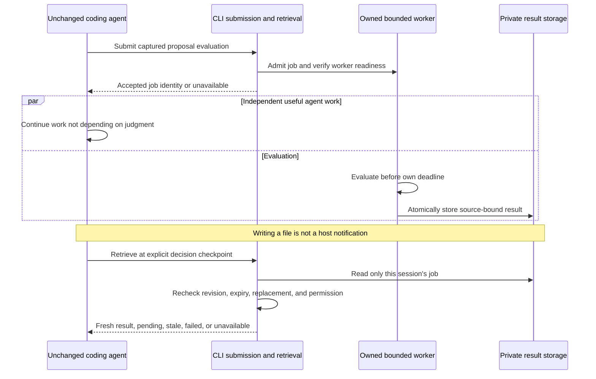

# Research: portable coding-agent integration and result delivery

> Historical research and session-bound proposal, not a current work order.
> The 2026-10-25 [stateless design](../system-design.md) and
> [ADR 0004](../decisions/0004-stateless-portable-consultation.md) supersede mandatory
> consent storage, durable verify, skills/adapters and related future-phase gates.
> No host was runtime-tested. Keep the primary-source evidence, not obsolete scope.

**Access date:** 2026-10-11. **Status:** primary-source research and proposed
integration specification, not implemented behavior. **Runtime tested:** none.

This document records the host/distribution evidence for an end-to-end design. The latest
assignment authorizes detailed planning, superseding older
[discussion-before-planning notes](../design-discussion.md). The user subsequently
conditionally authorized actual implementation after current todos/all planning
are complete: the orchestrator must close planning review, verification and push
before assigning bounded **offline code**. This documentation task itself performs
no implementation, install, host execution, live inference or experiment. Paid/live
calls, private-data transmission, coding-host launches, benchmarks, releases and
npm publication remain outside that conditional authorization.
The user has now accepted **CLI-first explicit consultation followed by opt-in
host-specific background adapters**, and **human scoped session/repo consent for
minimized selected-request/excerpt disclosure**. These accept direction, not
runtime execution, private-data transmission, a first native host, or all protocol,
rubric, budget, storage and authority details. The orchestrator owns contextual/ADR
updates, those remaining decisions, and reviewed documentation commit/push.

Read alongside [architecture](../architecture.md),
[ADR 0001](../decisions/0001-typescript-foundation.md), and
[ADR 0002](../decisions/0002-existing-agent-extension.md). A concurrent research
handoff records Jev/CLI evidence in [provider research](jev-cli.md). The
[legacy system design](../system-design-legacy.md) was the **proposed v0** command,
schema, numerical-policy and lifecycle contract. This research preserves supporting
evidence and alternatives, not a second competing protocol. Its earlier optional
workers/recipes are future possibilities, not features in v0.

## 1. Executive recommendation

**Accepted direction: CLI-first consultation, then opt-in host-specific background
adapters.** A thin Agent Skills-compatible instruction package is the proposed
portable discovery route. Keep the main agent, model, and runtime unchanged.

The canonical v0 proposal uses a human-enabled scoped local consent record,
noninteractive `consult`, offline `validate`/`verify`/`doctor`, one foreground HTTP
attempt with no automatic retries, and no daemon or background command. Exact
spellings, schemas, limits and review gates were in [legacy system design](../system-design-legacy.md),
not accepted constants inferred from this research. Session consent is a guardrail
for cooperating same-user callers, not hostile-agent isolation or a key vault.

The canonical contract now requires full output encoding/byte validation before
emission, no replacement stdout envelope after the first byte, and nonzero close
with `delivery-unknown` treatment when completed-result delivery is interrupted.
Callers discard judgment JSON on nonzero/inconsistent close even if it parses.
Local readiness/commit does not prove emitted success or consumption. Stored
completion/result-expiry timestamps support bounded cross-process verification;
only detectable clock inconsistencies are rejected. Undetectable between-process
rollback remains a stated machine-clock-trust limitation, not a guaranteed detection.
Exact historical rules live in [legacy system design sections 4–9](../system-design-legacy.md), not a second
research protocol.

The smallest proposed slice is a deliberate, public component proposal that the
agent submits for bounded judgment before committing to its implementation. The
judge receives the original request, applicable user/repository standards, proposal,
and selected source evidence. The ordinary shell/tool result returns a compact,
source-bound signal. It is advisory: the agent can refine an implicated component,
gather missing evidence, or explain why the signal is inapplicable. Jev does not
write the proposal, retrieve evidence, generate explanations, or approve actions.

This slice tests whether useful feedback can arrive at a real decision point with
little integration machinery. It does not test asynchronous benefit. After that
behavior is established, background work should reuse the same judgment semantics
and add either bounded explicit retrieval or a verified native delivery path.

The integration conclusions are:

1. **Shell + files + usable instructions is the portability floor, not a universal
   host guarantee.** An agent can use a new executable without a host-specific tool
   implementation if its environment permits executing it and returning output.
   Instructions must teach the command; its existence on `PATH` does not guarantee
   the model knows it or chooses it. Remote/cloud agents need their own provisioning.
2. **Skills distribute procedures, not execution services.** The standard defines
   `SKILL.md` and resources, not common hooks, process ownership, notification delivery,
   a mandated installation directory, or a mandatory permission grant. [S1, S2]
3. **Foreground consultation is broadly credible; universal proactive delivery is
   not.** A process can outlive a shell invocation without having any route back into
   the agent. A result file is storage, not a model notification.
4. **Claude Code and current Codex document native async hook feedback.** These are
   meaningful supported opportunities, with different timing and lifetime contracts.
   They do not splice feedback into private reasoning or an already-dispatched model
   request. Codex documents active-turn safe-point delivery; ordinary Claude async
   hooks document next-conversation-turn delivery. [C2, X2]
5. **OpenCode has incompatible v1/v2 plugin APIs.** V1 tool hooks are awaited;
   its general event callback is not awaited in the inspected release. V2 has
   Promise hooks, explicit cleanup, public event subscriptions, model-context hooks,
   and a synthetic inbox surface. A v1 adapter is not automatically a v2 adapter.
   [O1, O4, O5, O6, O7]
6. **A TypeSafe API key is separate from host authentication.** The current JS SDK
   reads `TYPESAFE_API_KEY`; no change to the host's model/provider setting is needed.
   An inherited environment is a practical setup route, not secret isolation from
   an agent that can execute arbitrary shell commands. [J1, J2]

Do not advertise “works automatically in any coding agent.” A defensible future
description is: “Consult from agents with supported shell/file access; discover
through compatible skills; enable automatic feedback on specifically tested hosts.”

## 2. Evidence method, identities, and limits

### 2.1 Evidence labels

| Label                 | Meaning                                                             | What it does not establish                                                       |
| --------------------- | ------------------------------------------------------------------- | -------------------------------------------------------------------------------- |
| **D: documentation**  | Current maintainer documentation describes a public contract        | Installed version, observed timing, permission configuration, or successful use  |
| **C: code inspected** | Relevant source/types were read at a named revision or tag          | The behavior was executed, every caller was traced, or the revision was deployed |
| **M: metadata**       | Package manifest, release metadata, or remote Git identity was read | A dependency is installed or a release passes integration tests                  |
| **P: proposal**       | Recommended Hunchcraft behavior derived from the use case           | An existing feature, accepted policy, or compatibility promise                   |
| **H: hypothesis**     | Possible workflow benefit or unresolved mechanism                   | Measured value or implementation proof                                           |

Independent documentation and code reads were batched in parallel. No specialist
was recursively delegated to. No package or host was installed or executed. No
secret was read and no inference endpoint was called. Git `ls-remote` was used only
to identify public upstream revisions; this is not a clone or a host runtime test.

### 2.2 Upstream identities

| Upstream              | Identity captured                                                                                                    | Evidence scope                                                                                                               |
| --------------------- | -------------------------------------------------------------------------------------------------------------------- | ---------------------------------------------------------------------------------------------------------------------------- |
| Agent Skills          | Unversioned live specification/integration guide                                                                     | D; standard format and guidance, not a tested host implementation                                                            |
| Vercel `skills`       | Manifest `1.7.2`; `13e4063a1cf913f5606d57d42ab83a86f5001e04`                                                         | D/C/M; installer mapping and junction/copy implementation                                                                    |
| `agent-browser`       | Manifest `0.39.0`; `d9570915f4dd6504dee4070379d2c4f79d81dbb2`                                                        | D/C/M; skill stub, README, daemon connection/spawn code                                                                      |
| OpenAI curated skills | `49f948faa9258a0c61caceaf225e179651397431`                                                                           | C; actual `gh-fix-ci` instructions                                                                                           |
| GitHub CLI            | `trunk` identity `ec5b512045db67e5a2a4ff4a1b02660b2fb24390`                                                          | D/C; live manual and help/auth guidance source; no installed-version claim                                                   |
| Claude Code           | Latest release metadata returned `v2.1.296`, published 2026-10-09                                                    | D/M; hook runtime implementation was not inspected                                                                           |
| Codex                 | Latest release metadata `0.162.1`; tag `rust-v0.162.1` resolves to commit `092d3acd6bec3e3a14bdc7e7a2810ab628ab759d` | D/C/M; release-tagged command hook runtime read; `main` identity also captured as `72f999edc7848961b99c4b98bf1e62d12fa35798` |
| OpenCode v1           | Tag `v1.18.29`, commit `16747470f976aca3d362ad730bcd3fe82ecc2c9a`                                                    | D/C; trigger, event, disposal, tool types, and session call sites                                                            |
| OpenCode v2           | `dev` commit `d21b0790a6c146815f28fea604e41e922f009590`; plugin manifest `@opencode/plugin` `2.0.26`                 | D/C/M; Promise adapter/types and live v2 docs; not proof of an installed v2 host                                             |
| TypeSafe JS SDK       | Live docs link source tag `v0.6.0`                                                                                   | D/C; credential construction, endpoint, abort/timeout and logging behavior                                                   |
| MCP                   | Specification `2025-11-25`                                                                                           | D; ordinary tools and experimental tasks, not host feature negotiation tested                                                |
| Node.js               | Child-process docs identify `v22.23.3`                                                                               | D; runtime APIs, not a change to Hunchcraft's accepted runtime floor                                                         |

Live pages and branch references can advance independently. The current docs do
not prove the earliest host version supporting every described feature. Minimum
supported versions must be selected and tested later. A release identity is not a
claim that Hunchcraft supports that release.

### 2.3 Source conflicts and unsuccessful lookups

- The `skills` README compatibility table says Codex hooks are unsupported, but
  current Codex hook docs and release-tagged runner code describe synchronous and
  asynchronous hooks. Prefer **Codex's contract** for Codex behavior. An installer
  table is not an authoritative feature matrix. [S3, X2, X3]
- The Agent Skills integration guide calls project-over-user precedence universal.
  Claude Code's skills page explicitly says personal skills take precedence over
  project skills; Codex documents duplicate names rather than a merge. Do not depend
  on universal name precedence. [S2, C1, X1]
- `/docs/` OpenCode pages describe v1; `/v2/docs/` pages describe v2. The migration
  page explicitly says v1 implementations do not run in v2. Separate these surfaces
  rather than “correcting” one into the other. [O1, O5]
- Historical source paths on OpenCode `dev`, such as
  `packages/opencode/src/plugin/index.ts`, returned 404. The v1 tag was readable;
  current v2 source uses different paths. A guessed v2 runner inbox path also returned
  404; no delivery algorithm was inferred from that nonexistent file. A guessed
  v2 `/sessions/` documentation route also returned 404; the public API and plugin
  pages were used for the session contracts instead.
- Raw Codex source URLs using its annotated **tag object** hash returned 404. Reading
  by tag succeeded; the GitHub tag-object API then resolved the commit identity above.
- A guessed generated GitHub CLI formatting Markdown file returned 404; the manual
  page and actual root help source were available instead.
- Legacy OpenAI docs URLs redirected to current documentation routes. Markdown
  retrieval worked for hooks/MCP/security. The old `security` URL now describes the
  Codex Security product, so it was **not** used as the sandbox contract; the explicit
  agent-approvals/security page was used.
- Some long fetched pages were truncated by the retrieval tool. Relevant Claude
  async/security sections were read from its saved output; no claim relies on an
  unseen truncated section. No broad production audit of any upstream was performed.

## 3. Compatibility tiers: separate discovery, execution, and delivery

These are proposed reporting tiers, not existing package capabilities. They are
not strictly cumulative: a host might expose MCP but not shell access, or support
hooks while refusing repository-local skills.

| Tier                                              | Required capability                                                                             | Discovery/invocation                                                                        | Result route                                                   | Honest limit                                                                                |
| ------------------------------------------------- | ----------------------------------------------------------------------------------------------- | ------------------------------------------------------------------------------------------- | -------------------------------------------------------------- | ------------------------------------------------------------------------------------------- |
| **T0: instructed CLI consultation**               | Shell execution, permitted file/input access, installed executable/runtime, usable instructions | User provides a procedure or host-recognized instruction file; agent deliberately calls CLI | Ordinary shell result, or explicit read of a returned artifact | No automatic skill loading, observation, or proactive delivery promised                     |
| **T1: skill discovery**                           | T0 plus documented skill loading in that environment                                            | Native skill catalog and model/user activation                                              | Same CLI result as T0                                          | Skill selection is model-dependent; slash/mention syntax and precedence vary                |
| **T2: cooperative background retrieval**          | T0 plus verified worker lifetime and accessible result storage                                  | Agent explicitly submits work and later retrieves it at a checkpoint                        | Poll/retrieve tool result; no native notification required     | Agent may forget, poll wastefully, or finish before retrieving; spawn alone is insufficient |
| **T3: automatic observation and native feedback** | Supported, enabled, trusted hooks/plugin plus documented model-visible delivery                 | Adapter observes a public event/artifact and schedules bounded work                         | Host context/async feedback at a supported safe point          | Host/version-specific; feedback may be late; no private-generation interception             |
| **Optional typed-tool surface**                   | A host supporting custom tools or MCP                                                           | Host registers a small named tool catalog                                                   | Normal tool result, or separately verified deferred retrieval  | MCP is not universal and its notifications need not become model context                    |

“Any agent” in T0 means **any agent satisfying the prerequisites**, not every named
product or every mode of a product. A web-only agent without executable access is
outside the CLI portability floor. A local IDE UI controlling a remote executor
uses the executor's filesystem, environment, permissions, and lifetime—not those
of the user's desktop terminal.

Unknown-host fallback:

1. Supply the human-readable procedure directly or ask the agent to read its file.
2. Explain prerequisites and data sharing before execution.
3. Verify executable availability and non-secret configuration with a future offline
   diagnostic path; do not infer availability from an install on another machine.
4. Use foreground consultation. If denied, report unavailable and continue the
   unassisted workflow where safe. Do not disable sandboxing or rewrite host settings.
5. Enable background or automatic behavior only after confirming the required
   contracts. Do not pretend a guessed slash command or tool name is registered.

## 4. What real skills and CLI augmentations do

### 4.1 Agent Skills: portable instructions, host-specific loading

The standard requires a directory with `SKILL.md`, YAML `name`/`description`, and a
Markdown body; `scripts/`, `references/`, and `assets/` are optional. It describes
progressive disclosure: metadata first, full instructions when activated,
supporting resources on demand. `compatibility` can state prerequisites.
`allowed-tools` is experimental with varying client support. [S1]

The integration guide distinguishes local filesystem discovery from remote/cloud
provisioning and file-read activation from a dedicated activation tool. The
`.agents/skills/` convention is widespread but **not mandated by the format
specification**. The guide is useful design guidance for host authors; Hunchcraft
must not build a custom host loader to make an unchanged host comply. [S2]

**P: skill packaging requirements for Hunchcraft**

- One short canonical consultation skill with standard fields and relative resource
  links. Keep host-only frontmatter, hooks, model settings, and slash syntax outside
  the portable baseline. No main-model override.
- State purpose and activation boundaries: bounded proposal judgment, not generic
  “always review everything.” Teach when _not_ to consult.
- Explain that the original request and authoritative clarifications must survive
  proposal preparation. Repository excerpts are data, not new authorizations.
- Include concrete commands only after the concurrent CLI specification settles.
  Require noninteractive behavior, finite waits, and actionable unavailable states.
- Reference installed-version instructions rather than indefinitely duplicating
  a full command manual in copied skills. Offline help must work without a key.
- Provide a manual-read fallback for T0 and separately documented host installation
  locations for T1. Installing instructions and installing the executable are two
  distinct operations; neither silently provisions credentials or hooks.
- Avoid a generic name that shadows bundled host skills. Report collisions and
  versions. Compaction may lose an artifact or procedure: teach recovery without
  rerunning paid inference just to redisplay an existing result.

### 4.2 Vercel `skills`: discovery/installation, not runtime delivery

The actual installer offers `add`, `find`, `list`, `remove`, `update`, and current
`use` flows. `add` accepts repository/local sources, lists skills before installation,
targets selected agents, and distinguishes project/global scope. [S3]

Examples of **upstream syntax**, shown for research only and not executed:

```sh
npx skills add vercel-labs/agent-skills --list
npx skills add vercel-labs/agent-skills --agent claude-code --agent codex
npx skills find typescript
npx skills list
```

The inspected `agents.ts` maps Claude Code to `.claude/skills`, and Codex/OpenCode
project installs to `.agents/skills`. Its installer copies into a canonical location
and links non-universal host directories, or copies directly in copy mode. On
Windows it uses junctions; failed linking falls back to copies. Detection largely
checks host configuration directories, not an executable's capabilities. [S4]

Consequences:

- “Installed for 79 agents” is distribution coverage, not 79 runtime integrations.
- A symlink/junction is not an access grant. Permission checks and remote mounts can
  still prevent reading its target. Copies can drift independently.
- Global path summaries are not always the actual destination: universal-agent
  installs can short-circuit to the canonical `~/.agents/skills` directory.
- Installer version `1.7.2` declares Node `>=22.20.0`, stricter than Hunchcraft's
  accepted runtime floor. Installer prerequisites need separate documentation;
  using it must not silently raise Hunchcraft's package engines. [S5]
- The README documents telemetry opt-out through `DISABLE_TELEMETRY` or
  `DO_NOT_TRACK`. Installation/source privacy must be reviewed separately from
  inference privacy. Pin/review installer and source revisions; do not authorize
  automatic package execution or broad `--all` installation just for convenience.
- `skills use --agent` launches supported agents with generated instructions. That
  convenience is not evidence of observing or feeding an already-running arbitrary
  host. Hunchcraft does not need an agent launcher as its integration foundation.

**P:** use an established installer as an optional instruction distribution route,
plus manual copy/read instructions. Do not depend on its feature table for host
contracts or implement a competing many-host installer in the first slice.

### 4.3 `agent-browser`: a skill stub plus real daemon ownership

This project is a concrete example of a CLI that agents consult without a custom
coding-agent harness. Its current skill stub tells the agent to load the real usage
guide through `agent-browser skills get core`. The executable serves instructions
matching its installed version. The stub has host-specific extras; that does not
make every extra part of the standard. [B1, B2]

Persistent browser state is not created by the skill. In the inspected Rust source:

- `ensure_daemon` checks connection readiness and version/config compatibility,
  starts a daemon when needed, and waits for readiness or an early failure.
- Unix uses a Unix-domain connection and a new session through `setsid`; Windows
  uses loopback TCP and explicit detached/new-process-group creation flags.
- Session/namespace identities select socket/port and sidecar locations.
- `send_command` writes a request and reads a response. Ordinary calls remain
  request/response even while the daemon persists.
- Lost-response handling distinguishes “not sent” from “outcome unknown.” Mutating
  operations are not blindly resent after bytes reached the daemon. [B3]

The README also describes deferred WebMCP invocation with explicit result/cancel
retrieval. Event discoveries can be appended to a **later ordinary browser
response**, rather than magically appearing in the coding agent's conversation.
Its independent dashboard and streaming service are UI/network facilities, not
universal model notification channels. [B1]

**P:** borrow the separation of version-matched instructions, explicit session
ownership, readiness, cleanup, and lost-response semantics. Do not borrow its
daemon complexity merely because it is a successful augmentation pattern. Browser
state requires persistence; one bounded network judgment may not.

### 4.4 GitHub `gh` and OpenAI's `gh-fix-ci` skill

`gh-fix-ci` is actual reusable instruction content that teaches authentication
preflight, PR/check retrieval, a bundled inspection script, bounded log snippets,
external-provider limits, and approval before implementing. It uses an existing
CLI instead of a host plugin. [G1]

GitHub CLI separates authentication from workflow invocation:

- `gh auth login` can use browser authentication and system credential storage,
  with a documented **plaintext fallback** if storage is unavailable.
- `--with-token` reads a token on stdin; environment authentication is documented
  for headless use. Its auth is GitHub-specific, not available for TypeSafe. [G2]
- Normal results are plain text; selected commands support `--json`, `--jq`, and
  templates. The CLI help exposes actual fields and actionable auth guidance.
  `--jq` does not require a separately installed `jq`. [G3, G5]
- `gh run watch` polls until completion; its documented refresh interval is seconds.
  An example explicitly chains a desktop notification command. Watching progress
  does not itself inject feedback into a coding agent. [G4]

**P:** adopt one-time setup, offline help, non-secret diagnostics, human and machine
output, and explicit recovery. Do not promise a `gh`-like login flow or credential
store for Hunchcraft until that feature is separately designed. Do not copy its
plaintext fallback as a silent default.

## 5. Host claim matrix: observation, await, delivery, lifecycle

The matrix records upstream capabilities. A usable Hunchcraft adapter remains a
proposal. “Context” means model-visible supplied material at a documented boundary,
not access to private reasoning.

| Surface/evidence                                                | Public observation                                                                                        | What is awaited                                                                                                  | Model/result delivery                                                                                               | Lifecycle and material limits                                                                                                                                               |
| --------------------------------------------------------------- | --------------------------------------------------------------------------------------------------------- | ---------------------------------------------------------------------------------------------------------------- | ------------------------------------------------------------------------------------------------------------------- | --------------------------------------------------------------------------------------------------------------------------------------------------------------------------- |
| Ordinary shell CLI; Node D                                      | Only supplied input/files and what the CLI is permitted to read                                           | Depends on host shell tool; an ordinary invocation waits for response/exit unless host explicitly backgrounds it | Captured stdout/tool result; later file read is explicit                                                            | Sandbox, key inheritance, executable location, output truncation and shell lifetime must be checked per host                                                                |
| Claude skills; D [C1]                                           | Skill invocation arguments, deliberate artifacts; dynamic shell context only when that feature is allowed | Loading/invoking the skill is not a detached worker; shell commands have their own await behavior                | Inline instructions/tool outputs; host-specific forked skill behavior exists but is not the portable baseline       | Native `.claude/skills` paths, invocation controls, context budget, cloud/local differences, possible name shadowing                                                        |
| Claude sync hooks; D [C2]                                       | Session/prompt/tool/stop event JSON; session identity, cwd, event-specific input/output                   | Default hooks block until completion, subject to event/type timeout                                              | Event-specific `additionalContext` or control fields; plain stdout is not universally model context                 | Commands have full user permissions; trust/managed settings matter; event schemas differ                                                                                    |
| Claude `async: true`; D [C2]                                    | Same hook event input as sync                                                                             | Host starts command and continues without waiting for completion                                                 | Valid JSON `additionalContext`/`systemMessage` on next conversation turn; idle waits for user interaction           | Only command hooks; ordinary async timeout is not enforced once backgrounded; each invocation creates a process; `-p` teardown kills unfinished hooks                       |
| Claude `asyncRewake`; D [C2]                                    | Same supported command hook input                                                                         | Nonblocking command; timeout still enforced                                                                      | Exit 2 wakes Claude even while idle; stderr, or stdout if stderr empty, becomes a system reminder                   | A special wake mechanism, not ordinary async behavior or a universal CLI exit code; can add turns/cost                                                                      |
| OpenCode v1 custom tools / before-after hooks; D/C [O1, O2, O6] | Tool args/result, session/call identity; `chat.message` supplies public user message/parts                | `Plugin.trigger` yields each callback sequentially; tool execution waits before/after result completion          | Return tool result or mutate the supported after-hook output; normal tool continuation sees it                      | Tool context includes `abort`, session/message, directory/worktree; plugin has explicit `dispose` in inspected tag; custom code must enforce its own I/O policy             |
| OpenCode v1 `event`; D/C [O1, O6]                               | Public bus events, scoped to loaded directory in inspected implementation                                 | General event callback promise is **not awaited** in inspected tag, unlike trigger hooks                         | Event alone has no model delivery; use a separate supported API/checkpoint                                          | Handler must own and catch work; events are not an exactly-once job queue; dispose and session filtering required                                                           |
| OpenCode v1 SDK context insertion; D/C [O3, O6]                 | SDK session/messages, explicit plugin access                                                              | `session.prompt` with `noReply` returns after message creation, without running response loop                    | `noReply: true` adds a user/context message, not proactive wake                                                     | Busy-session ordering and next-request timing need tests; `noReply` is not a pre-consumption freshness gate                                                                 |
| OpenCode v2 hooks/tools; D/C [O4, O7]                           | Prompt admission, tool execution, assembled next model context, session identities                        | Promise callback is wrapped as an Effect operation; do not regard async callback syntax as fire-and-forget       | Normal tool return; `ctx.session.hook("context", ...)` can edit outgoing model material before dispatch             | Registration/unload cleanup; tool `context.signal`; transforms are synchronous; no default callback deadline established in this research                                   |
| OpenCode v2 events/inbox; D/C [O4, O7, O8]                      | Public async event stream and session/inbox reads                                                         | Slow stream consumption creates backpressure; buffer/admit before slow judgment                                  | `session.synthetic` admits identified synthetic input; `resume` controls scheduling; `delivery` has `steer`/`queue` | Admission receipt is not consumed feedback; subscriptions are live-only/no automatic replay/reconnect in client docs; plugin location is not every event's session location |
| Codex skills; D [X1]                                            | Deliberate artifact and skill resources, no hidden generation                                             | Model-selected or explicit skill loads; ordinary shell/tool contract applies                                     | `/skills` or `$skill` in CLI/IDE, then ordinary tool results                                                        | `.agents/skills` ancestors/user/admin; duplicate names; optional `agents/openai.yaml`; catalog can shorten/omit skills                                                      |
| Codex sync command hooks; D/C [X2, X3]                          | Session/prompt/local tool/stop JSON; session and turn identity, limited tool coverage                     | Host waits; matching command hooks launch concurrently                                                           | Supported event-specific `additionalContext`, UI `systemMessage`, and sync control fields                           | Hook hash trust; timeouts in seconds; default generally 600; SessionEnd/Interrupt much shorter; transcript format explicitly unstable                                       |
| Codex async command hooks; D/C [X2, X3]                         | Same supported event JSON                                                                                 | Nonblocking; eight concurrently executing per session, additional work waits                                     | Next safe model request after active model/tool work; if idle, next user turn; does not start a turn                | Timeout still enforced; reversed completion possible; session end cancels unfinished work and discards undelivered output; no finite waiting-queue bound established        |
| Codex MCP tools/hooks; D [X2, X4]                               | Tool args and output; MCP does not expose arbitrary host thought state                                    | Ordinary tool call or synchronous MCP hook, with tool/hook timeout                                               | Tool response/event-specific hook context; no general proactive channel established                                 | Stdio/HTTP, separate auth/environment and policies; MCP hooks need an existing connection, do not reconnect, and do not run on SessionEnd                                   |
| MCP experimental tasks; D [M2]                                  | Requestor-supplied operation/state                                                                        | Task creation returns handle; `tasks/result` waits for terminal result                                           | Polling/deferred retrieval; status notification is optional                                                         | Capability/tool-level negotiation, TTL, cancellation, authorization; protocol does not mandate model wake or current-host support                                           |

### 5.1 Important await distinction

Three meanings of “async” must stay separate:

```text
JavaScript Promise / nonblocking OS spawn
    != host releases the current tool/hook continuation
    != host delivers a later result to the model
```

An OpenCode tool that awaits Jev is a foreground consultation even if network I/O
does not block the event loop. An awaited hook that waits for Jev delays its host
boundary. A short submission hook can schedule work and return, but only an owned
worker plus a separate delivery/retrieval contract makes that useful background
assistance. Provider-level fan-out also does not establish host nonblocking behavior.

### 5.2 Claude Code details and constraints

The reviewed docs describe skills in native project/user directories, explicit
`/skill-name` invocation, model selection from descriptions, host-specific dynamic
context injection, and frontmatter hooks. Current skill hooks remain registered
for the rest of the session after activation; `once` offers a narrower lifecycle.
These are Claude extensions, not portable standard behavior. [C1, C2]

For proposed automatic evaluation, `UserPromptSubmit` can preserve the request,
but it has **no proposal yet**. A post-tool event can observe a deliberately written
proposal artifact; it does not recover a plan from private generation. `Stop` sees
completed response material and is often too late for the original planning
decision. A `Notification` hook observes a host notification, not a generic inbound
notification API.

Ordinary async hooks document next-turn feedback and no enforced background timeout.
Use an independent Hunchcraft deadline even if a config includes `timeout`.
`asyncRewake` is technically promising for idle delivery, but requires a separate
authority/wake policy: using a failure-oriented exit mechanism to wake on every
advisory judgment could create unnecessary turns and misleading errors.

At the observed release era, pretty-printed async JSON alone on stdout requires
v2.1.295 or later. Earlier versions need compatible single-line output. Do not
print progress logs into a host-specific JSON response channel. A future adapter
must render its own envelope rather than forward an ordinary CLI JSON object
unchanged. [C2]

**Security warning:** command hooks, MCP servers, and helper processes run outside
Claude's shell sandbox. The docs warn that command hooks have full user permissions.
Native Windows shell sandboxing is not supported; WSL2 has a separate supported
sandbox path. Headless `-p` trust behavior differs from interactive workspace trust.
Review repository hook settings before headless execution. [C2, C3]

### 5.3 OpenCode details: keep v1 and v2 separate

**V1:** the tagged `Plugin.trigger` implementation runs matching before/after
callbacks sequentially as yielded Promise effects. The session tool wrapper yields
before-hook, tool execution, and after-hook in order. A plugin can modify the
supported result returned by a tool; doing so after the tool ran cannot undo its
side effects. [O6]

By contrast, the tagged general event listener calls the callback without awaiting
its Promise. This establishes an actual observation opportunity, **not** safe
background scheduling: the adapter still needs captured state, bounded admission,
error handling, and disposal. Its late result cannot mutate an old hook's output
and expect the next model call to notice.

The documented v1 SDK `noReply: true` path creates context without running the
response loop, confirmed in tagged prompt code. It does not establish ordering
against an in-flight model request. A toast or appended TUI prompt is UI delivery,
not proof the model received judgment context. Avoid calling `session.prompt` with
ordinary response behavior inside an awaited hook on that same session: reentrancy
and extra agent work are material risks requiring a traced/tested path.

**V2:** the plugin entrypoint is `Plugin.define({ id, setup })` from
`@opencode/plugin`. `setup` can return cleanup; registrations are disposed on
unload. Promise session/tool hooks are wrapped in Effect operations, and tool
executors receive a cancellable signal. This supports thin adapters without
requiring Hunchcraft's core/application to adopt Effect. [O4, O5, O7]

The v2 `context` hook runs immediately before an agent-loop model call and edits
outgoing material rather than persisted history. It is a stronger possible
freshness/consumption checkpoint than blindly appending a result earlier. A
proposed adapter could insert **already completed, freshly validated** feedback
there, without awaiting inference on every model request. That is a proposal,
not an implemented pipeline or a zero-latency guarantee.

`session.synthetic` is a documented admission/scheduling surface with optional
`resume` and inbox delivery semantics. The returned inbox item is admission, not
evidence of consumption or action. The public API labels session routes
experimental; this deserves a compatibility window and tests. Do not promise
mid-generation injection simply because the inbox supports `steer`. [O8]

The v2 client event stream has live-only/no replay/no automatic reconnection
semantics and shared-source backpressure. A worker should not perform network
inference inside its stream-consumption loop. On a gap, resynchronize from
authoritative state or report the lost observation; never claim complete coverage.
Plugin instance location is not a session-isolation boundary. [O4, O9]

### 5.4 Codex details: current hooks exist

Current Codex docs expose a much richer hook contract than old notify-only
descriptions. Non-managed hooks require trust in the exact definition hash;
project-local config also requires project trust. Hook installation/enablement is
not permission to run all future changed hook content. [X2]

Useful public events include `UserPromptSubmit`, `PreToolUse`, `PostToolUse`, and
`Stop`, with session/turn identities and event-specific fields. Shell, unified exec,
patches, MCP, and most local function tools are covered; hosted tools are not.
Later unified-exec polling can produce the original command's post-tool event.
`transcript_path` is convenient but its format is explicitly unstable: prefer
documented event data and an explicit artifact over transcript scraping.

Native async output is informative only. It cannot retroactively approve, reject,
rewrite, or stop the triggering operation. Active turns receive it after current
model/tool work at a safe next model request; idle sessions wait for a user turn.
This is genuine native feedback, not an arbitrary detached subprocess pattern.

The release-tagged runner confirms an eight-per-session semaphore, independently
scheduled tasks, control-feedback stripping from async output, timeout covering
stdin writes/output waits, and shutdown abort/drain behavior. It uses process-group
cleanup on Unix and Windows Job Object/taskkill fallback for unfinished processes.
It can preserve descendants of a successfully completed hook. [X3]

**Limits important to Hunchcraft:** eight executing hooks does not bound the number
waiting; the inspected scheduler adds tasks awaiting permits without a finite
admission cap. Timeout starts when execution begins, not at Hunchcraft's proposal
capture. Output spilling bounds model-visible context but does not establish a
finite producer-output capture budget. Hunchcraft needs its own intake, age,
byte, and spend limits.

Codex MCP supports local stdio and Streamable HTTP with separate environment/auth
configuration. Normal MCP availability does not prove experimental MCP Tasks or
unsolicited model notification support. Dynamic app-server custom tools and external
turn steering are not selected here: requiring a replacement client/harness would
violate the accepted boundary. Existing skills/hooks/MCP suffice for the proposed
portability strategy. [X4]

## 6. Proposed end-to-end flows

The diagrams show only concrete workflow proposals justified by the sources above.
Operation labels are behavioral pseudocode, **not CLI spellings or schemas**.

### 6.1 Portable foreground consultation

```mermaid
sequenceDiagram
    participant U as User
    participant H as Unchanged coding agent
    participant C as Hunchcraft CLI
    participant A as Application policy
    participant J as Jev provider
    U->>H: Original request and authorized constraints
    H->>H: Read relevant repo evidence
    H->>H: Emit provisional public component proposal
    H->>C: Consult with request, proposal, standards, evidence
    C->>C: Validate input, configuration, and disclosure permission
    C->>A: Admit bounded evaluation
    A->>J: Focused typed questions over captured state
    J-->>A: Typed judgments and probabilities
    A->>A: Bind result to source identity and check applicability
    A-->>C: Judgment or explicit unavailable outcome
    C-->>H: Ordinary bounded shell/tool result
    H->>H: Check freshness; target evidence gathering or revision
    H-->>U: Continue with ordinary host workflow
```

No hidden reasoning is required. One plan critique need not invent alternative
plans. Noul suits a bounded condition, Score a defined degree, and Choice one of
explicit candidates; the reusable check/rubric author owns the semantic choice.
Do not convert this workflow into “Jev generates a better plan.” [J1]

Foreground acceptance obligations:

- The explicit request is not replaced by an LLM summary. Missing source evidence
  is an identified limitation, not fabricated support.
- A well-formed input can still be insufficient for a useful judgment; validate
  mechanical completeness separately from semantic sufficiency.
- The call has a finite application deadline, bounded inputs/questions/output,
  and explicit failure. No interactive credential prompt inside agent execution.
- Feedback retains exact check/subject association and evidence provenance. The
  renderer may point to supplied evidence but cannot invent Jev-authored explanations.
- CLI stdout is the normal response channel; diagnostics must not contaminate
  machine-readable output. The host may truncate it, so the decisive summary must
  stand alone and indicate any omitted material.
- A positive judgment grants no new permission and is not implementation proof.

### 6.2 Cooperative background: execution survives, delivery is retrieval



This can be background **execution** without proactive delivery. It is valuable
only if the agent has independent work and reliably retrieves before the relevant
decision passes. A daemon is optional; a finite one-shot worker can be sufficient
if process lifetime, storage, and cross-process admission are proven.

**P:** do not tell agents to invent `nohup`, `&`, or `Start-Process` launch recipes
for Hunchcraft. If detached execution is later selected, the executable owns the
cross-platform mechanism, readiness, cleanup, and bounds. A submission receipt
must not report success before job ownership is established.

### 6.3 Automatic/native delivery: three adapters, not one magic channel

```text
Public artifact/event
    |
    v
Host-specific observer --> validate/filter --> bounded application admission
                                               |
                                    captured-state Jev evaluation
                                               |
                                               v
                                    result + source identity
                                               |
             +---------------------------------+----------------------+
             |                                 |                      |
     Claude command-hook                 Codex command-hook    OpenCode plugin
     JSON feedback                       informational output   result cache
             |                                 |                      |
     next conversation turn              next safe model       fresh consume at
     (or separately approved             request / next user    context hook, or
      asyncRewake policy)                 turn if idle           supported inbox
```

For Claude/Codex native async hooks, the host can queue output between hook
completion and consumption. A completion-time freshness check is not enough.
Possible approaches, to be selected later:

1. Native feedback carries a non-secret result reference and source identity;
   instructions require retrieval/validation before acting. Stronger freshness,
   extra tool turn, and still model-dependent compliance.
2. Deliver the immutable judgment with explicit source identity and tell the agent
   to compare current task/proposal/evidence before use. Lower overhead, weaker
   enforcement; never call it guaranteed fresh.
3. A host adapter consumes from its cache at a documented pre-model checkpoint
   and validates then, as proposed for OpenCode v2's context hook. Better timing
   control, but narrower portability and additional adapter maintenance.

Automatic observation should filter for an explicit, stable public artifact or a
well-defined tool output. Watching every token, recursively reading entire repos,
or judging every file write would add noise, privacy exposure, and unbounded cost.
Automatic feedback must exclude its own submissions/results to prevent loops.

## 7. API-key setup: exact known mechanism, no imaginary CLI API

### 7.1 What is known

TypeSafe's JS docs specify `TYPESAFE_API_KEY`; `TypeSafeClient` can also receive an
explicit `apiKey`. The `v0.6.0` source reads the key during client construction,
uses it in the authorization header to `https://api.typesafe.ai`, and posts
System One requests to `/v1/systemone`. It does not use Claude/Codex/OpenCode
credentials. Its default model alias is not a host model replacement. [J1, J2]

**P:** resolve credentials during explicit CLI/composition startup and inject into
the provider. Importing Hunchcraft must not read keys or start work. A portable
skill should refer to the variable name, never contain the key or request the
agent to display it. Missing credentials produce an actionable unavailable state
with no inference request.

### 7.2 Human-operated inherited-environment route

These are exact **shell environment operations**, not Hunchcraft commands. They
are a proposed setup recipe for a future CLI using the documented SDK variable.
They have not been executed in this research. The human enters the key in their
own trusted terminal before launching the chosen host from that same environment.

Linux with Bash:

```bash
read -r -s -p 'TypeSafe API key: ' TYPESAFE_API_KEY
printf '\n'
export TYPESAFE_API_KEY
```

Windows PowerShell 5.1 or PowerShell 7:

```powershell
$key = Read-Host 'TypeSafe API key' -AsSecureString
$env:TYPESAFE_API_KEY = [System.Net.NetworkCredential]::new('', $key).Password
Remove-Variable key
```

Then launch the unchanged coding agent with its **normal documented launch
command**, in that terminal. On a future CLI invocation, if the host forwards the
variable without scrubbing and permits the network request, the provider can use
it without asking for a key each time. Launching a fresh host from another desktop
shortcut or already-running IDE does not imply it inherited this terminal's
environment. Restart/relaunch or use the host's supported executor-secret mechanism.

To remove the variable from the terminal after closing the relevant child sessions:

```bash
unset TYPESAFE_API_KEY
```

```powershell
Remove-Item Env:TYPESAFE_API_KEY
```

Unsetting the parent does **not** remove the already inherited key from running
children. Environment transport is plaintext in process memory, including after
the PowerShell secure prompt converts it. Do not imply the key is inaccessible
to the host, same-user processes, or an agent with arbitrary shell access.

### 7.3 Conditions for “seamless” to be honest

| Condition               | Required behavior / limitation                                                                                                            |
| ----------------------- | ----------------------------------------------------------------------------------------------------------------------------------------- |
| Executable installation | Install/pin runtime and CLI separately from skill content, in the actual executor; no auto-install during an evaluation call              |
| Key provisioning        | Human/secret manager supplies key once; baseline has no chosen credential-store implementation                                            |
| Environment forwarding  | Check host policy; scrubbers/allowlists can remove `TYPESAFE_API_KEY`; remote executors need their own provisioned secret                 |
| Network                 | Explicitly allow the intended provider endpoint according to host/org policy; docs access does not imply inference endpoint access        |
| Proxy/TLS               | Node/provider fetch must honor the supported proxy/trust route; domain allowlisting alone does not prove JS fetch reaches a sandbox proxy |
| Permissions             | Narrow authorization for consulting and sharing selected data; no bypass flags or broad interpreter allow rules as a setup shortcut       |
| Session refresh         | Key changes do not necessarily update existing worker/host environment snapshots; define reload/rotation and restart behavior             |
| Diagnostics             | Report installed versions, configured/not configured, execution environment, and capability mode without revealing key/source contents    |
| No host model changes   | Host continues with original LLM/authentication; separate Jev account usage/spend is visible to the user                                  |

The concurrent CLI handoff must settle exact install/help/auth/consult/retrieve
syntax and configuration precedence. This document cannot honestly provide a
working Hunchcraft invocation today: the repository has no CLI capability or `bin`
entry. A fully copy-pasteable Hunchcraft setup guide belongs after that specification
is reconciled and later implemented/tested, not as invented commands in research.

### 7.4 Threat boundary and privacy

Environment credentials are convenient but not a hostile-agent isolation mechanism.
If “the agent must never access the actual key” is required, a separately trusted
broker/credential boundary needs design, approval, and tests. A credential store
alone is insufficient if every arbitrary shell command can retrieve the secret.
Do not silently start an unsandboxed daemon to route around a sandbox denial.

The provider source's debug logging includes request/response bodies even though
auth headers are redacted. Hunchcraft must control provider logging and avoid
turning on body logging by default. API-key redaction is not source-code privacy.
Do not place keys in CLI args, host prompts, `SKILL.md`, committed config,
proposal/result files, stdout, debug bundles, or benchmark fixtures. [J2]

Data-sharing authorization is separate from permission to read a file locally.
For the proposed baseline, send only explicitly selected, authorized material;
do not sweep transcripts, `.env`, credentials, unrelated directories, or full
repositories. Redaction cannot promise discovery of every secret. Provider data
retention, region, logging, and account terms remain an explicit unresolved decision
to reconcile with the provider research.

## 8. Lifecycle, isolation, bounded work, and cross-platform obligations

These are proposed implementation requirements, independent of wire format.

### 8.1 Identity and freshness

- Bind every evaluation to executor/workspace or canonical repository identity,
  worktree, host/session identity, subagent identity where applicable, request,
  proposal revision, evidence snapshot, applicable standards, and check/model version.
- A path or Git HEAD alone is not a working-state revision: uncommitted edits,
  clarifications, changed standards, and replacement proposals can invalidate a result.
- Retain supplied contents or their immutable reference/fingerprint, not merely
  filenames. Decide exactly which changes invalidate each check; age is an extra
  limit, not the definition of freshness.
- Capture at admission, validate at delivery, and recheck before consumption when
  the host exposes a usable checkpoint. If not, label the residual race and require
  explicit revalidation. Do not represent stale as “negative” or failed as “positive.”
- Host session IDs need host/executor namespace. The same repo/worktree can contain
  simultaneous sessions; worktree-scoped IDs alone do not isolate them.
- Fork/resume/clear/compaction need an explicit policy. Copied conversation context
  must not grant a child session access to a different session's pending jobs.

### 8.2 Scheduling and deadlines

- Bound input/output **bytes**, questions/candidates, in-flight requests, queued
  work, duplicate submissions, attempts, retained artifacts, and total spend/usage.
  Choose actual values with the evaluator; no defaults are selected here.
- Cross-process limits cannot be enforced only by an in-memory counter in each
  one-shot hook. Use an approved shared owner/admission mechanism if automatic
  hooks can run concurrently. Host concurrency limits are not Hunchcraft budgets.
- Deadline includes queue wait, preparation, transport attempts/backoff, result
  persistence, and useful delivery. Record local duration in milliseconds and an
  explicit absolute expiry representation in the later protocol. Hook timeout
  fields are seconds; SDK attempt timeout is milliseconds. [C2, X2, J2]
- TypeSafe's inspected timeout is **per attempt**. A bounded SDK timeout alone does
  not bound retries plus backoff or host queuing; apply an application-owned total
  deadline/abort signal. Cancellation cannot undo already disclosed data or guarantee
  provider-side billing stopped.
- Coalesce or supersede obsolete revisions; do not retry replaced work. Define
  saturation behavior before implementing, and expose dropped/superseded counts.
- No infinite propose/judge loop, forced Stop continuation, wake-on-every-result,
  periodic full-repo scans, or uncontrolled speculative fan-out.

### 8.3 Process ownership and shutdown

Node's `spawn` is asynchronous to its event loop. `detached`/`unref` plus suitable
stdio can let work outlive a parent under OS semantics, but containers, job objects,
sandbox cleanup, shell tools, and cloud teardown may still kill it. Node documents
different Unix/Windows behavior and warns that pipe capacity can block an unread
producer. [N1]

For a later worker implementation:

1. Establish owner, session scope, readiness, endpoint/artifact access, finite
   lease/deadline, and restart semantics before returning acceptance.
2. Handle spawn failures, unknown outcomes, broken pipes, rejected promises, and
   partial writes. No `void promise` without owned rejection handling.
3. Stop intake before disposal; cancel owned work; release subscriptions/timers;
   suppress late delivery; close resources. Do not kill unrelated processes using
   a stale PID file or assume PID liveness proves the correct worker.
4. Session cleanup is advisory under abrupt termination. Add expiry/recovery so
   missed SessionEnd does not leave unlimited work or sensitive data behind.
5. Do not allow ordinary CLI exit, native hook cancellation, and user-requested
   job cancellation to be accidentally treated as the same lifecycle event.
6. A detached grandchild's output is not the parent hook's output. Native hook
   feedback requires that the host-managed hook actually returns its supported
   response, or that another verified host event later retrieves the result.

### 8.4 Files and IPC

- State outside source-controlled instructions; no result writes under protected
  `.agents`, `.codex`, `.claude`, or `.git` paths. A cache needs permission to write
  its actual location; read-only planning modes might require a permitted temp route.
- Session-scoped directories and atomic completed-result publication; reject path
  traversal and mismatched identities. Protect against symlink/junction escape and
  same-name collisions. Do not use untrusted repo text as shell arguments.
- Unix file modes are not Windows ACLs. Define both; never treat a random filename
  as the sole confidentiality boundary. Same-user hostile processes remain a limit.
- If IPC is selected, authenticate/authorize local clients and bind scope. Loopback
  TCP is not automatically private; Unix sockets have path-length/permission limits.
  Named pipes are an alternative requiring their own Windows tests, not a decision.
- Expire results and evidence snapshots, with opt-in diagnostic retention. Avoid
  global job listing that leaks other sessions' tasks. A result reference is not
  authority to consume another session's result.

### 8.5 Windows/Linux execution and sandboxing

- Prefer a direct `node` executable plus a validated script path/argument vector
  for adapter-owned spawning where supported. Windows npm `.cmd`/`.bat` shims
  require shell handling; `execFile` cannot launch them as native executables.
  Claude's documented exec form has the same limitation. [N1, C2]
- Do not put JSON, credentials, or source evidence into a shell command string.
  Use the later approved stdin/file input contract. Quote paths with spaces in
  shell examples; avoid Bash-only dependencies in the portable skill.
- Explicit UTF-8 handling and tests for CRLF, non-ASCII paths/content, PowerShell
  5.1 encoding, Linux permissions, native Windows, and WSL2 as distinct executors.
- Codex ordinary commands default to network-off workspace sandboxing; current
  Linux docs name `bwrap`/`seccomp`, and Windows/WSL paths differ. Network proxies,
  MCP connections, hooks, and ordinary commands can have **different boundaries**.
  Verify the particular route, not just a global “sandbox enabled” indicator. [X5]
- OpenCode permission rules gate host tools, but its v2 policy docs explicitly
  say policies do not sandbox plugin code. A custom tool/plugin must request any
  applicable host permission and apply its own disclosure/runtime restrictions;
  host provider bans are not guaranteed to constrain direct plugin HTTP. [O10]
- Test deny behavior rather than recommending broad allow/bypass settings. Hooks
  and plugins are executable trust decisions; installing a skill is not consent to
  automatic network disclosure or to changing user security configuration.

## 9. Recommended boundaries and proposed module placement

Placement is illustrative until the concurrent design agrees concrete contracts.
No source files or exports are created by this handoff.

```text
Composition startup (CLI / selected host entrypoint)
    | resolves config and injects concrete adapters
    +--> integrations/cli             input/output boundary
    +--> integrations/<selected-host> observation/delivery boundary
    +--> providers/typesafe           SDK/HTTP boundary
                    \                 /
                     application     bounded consult/job lifecycle
                          |
                         ports       only concrete I/O needs
                          |
                         core        pure identity/applicability semantics
```

| Placement                             | Proposed responsibility                                                                 | Contract obligation / keep out                                                                            |
| ------------------------------------- | --------------------------------------------------------------------------------------- | --------------------------------------------------------------------------------------------------------- |
| `src/core/`                           | Source identity, judgment binding, pure applicability rules once selected               | No host SDK, process/env, filesystem, or network                                                          |
| `src/ports/`                          | Concrete provider and, when needed, clock/storage/result-delivery contracts             | Hunchcraft-owned types; no speculative universal host bus                                                 |
| `src/application/`                    | Foreground consultation first; later bounded submission/retrieval and fresh consumption | Total deadline, saturation, replacement, cancellation and result authority policy; no host JSON envelopes |
| `src/providers/typesafe/`             | Translate typed questions/answers and provider errors                                   | Injected key/config; SDK types stay here; no host scheduling/actions                                      |
| `src/integrations/cli/`               | Parse/validate external input and render bounded ordinary output                        | No direct concrete provider construction; no interpreting repo data as executable instructions            |
| `src/integrations/claude-code/`       | Only if selected: hook event adapter and event-specific feedback renderer               | Claude JSON/exit/wake semantics here; no aliases to generic CLI exit codes                                |
| `src/integrations/codex/`             | Only if selected: trusted hook parsing, identity mapping and async feedback             | Versioned tool/event coverage and output rules; no unstable transcript parser as baseline                 |
| `src/integrations/opencode/`          | Only if selected: v1/v2-specific boundary modules or separate entrypoints               | SDK types remain local; cache/context/inbox delivery explicit; no sibling adapter imports                 |
| `src/composition/`                    | Executable startup and factories wiring providers/application/integrations              | Explicit initialization/disposal and config precedence; inert package imports                             |
| Shipped skill resources, location TBD | Short portable procedure plus version-matched references                                | Distinct from development skills; package payload and installer discovery tested later                    |
| `tests/`, later owned paths           | Offline cross-module/host fixture contracts                                             | Fakes, deferred promises, controlled time, no default live keys/calls                                     |

Boundary behaviors to hand to the developer, without selecting wire shapes:

- **Consultation:** validated supplied state + authorized evaluation intent + total
  deadline/cancellation → bound judgment or explicit unavailable/error outcome.
- **Admission, only if background selected:** request + source/session identity +
  work limits → accepted ownership identity or rejected admission; no optimistic
  receipt before ownership.
- **Retrieval:** caller scope + job reference + current applicability state → fresh,
  pending, stale, superseded, expired, failed, or unavailable; exact taxonomy belongs
  to the consolidated specification.
- **Host delivery:** freshly validated result/reference + target session → a host
  receipt whose meaning is precisely documented: queued, context inserted, or
  unavailable. Do not call “queued” “consumed.”
- **Disposal:** idempotently stop admission and owned work, release resources, and
  prevent further delivery. Host reload is disposal plus a new instance, not reuse
  of stale singleton state.

MCP, if later justified, is another integration over the same application behavior,
not a second decision engine. Its `structuredContent`/output schema can preserve
typed results; compatibility text is still needed where a host exposes only text.
MCP Tasks remain experimental and requestor-driven, with optional notifications;
no initial dependency on them is recommended. [M1, M2]

## 10. Alternatives, tradeoffs, and reconsideration triggers

| Alternative                                  | Strength                                                                  | Cost / failure mode                                                                                  | Recommendation                                                            |
| -------------------------------------------- | ------------------------------------------------------------------------- | ---------------------------------------------------------------------------------------------------- | ------------------------------------------------------------------------- |
| CLI + manual instructions                    | Broadest practical baseline, simple failure/review surface                | Manual discoverability; model can ignore procedure; shell/data permissions required                  | Foundation for T0                                                         |
| CLI + standard skill                         | Progressive disclosure and reusable workflow; existing installers         | Different discovery/precedence, copied docs drift, selection not guaranteed                          | Add thin T1 packaging, not runtime claims                                 |
| Agent backgrounds ordinary shell command     | Potentially minimal host-specific code                                    | Shell-tool lifetime/cleanup/output capture vary; easy to orphan work; no automatic feedback contract | Not a portable documented recipe                                          |
| CLI-owned finite worker + explicit retrieval | Can overlap independent work across T0 hosts                              | Process/readiness/state/admission complexity; polling turns and unused results                       | Add only if whole-loop overlap value is plausible and lifetime tests pass |
| Native Claude/Codex async command hook       | Real nonblocking observation and native context feedback                  | Event-specific output, trust, different deadlines/idle behavior; cannot control past action          | Credible opt-in automatic candidate, not first universal dependency       |
| OpenCode plugin with pre-model consumption   | Explicit observation, cancel/dispose, strong consumption checkpoint in v2 | Narrow portability, v1/v2 maintenance, awaited callbacks/backpressure                                | Credible optional candidate; version selection through orchestrator       |
| MCP wrapper                                  | Typed discoverable tool surface in multiple hosts, can avoid shell syntax | Config/auth/tool catalog overhead; connection timeouts; no universal wake guarantee                  | Defer until shell restriction or tool UX justifies it                     |
| Custom harness, host fork, main-model swap   | Could create arbitrary observation and turn control                       | Violates ADR 0002; changes experiment and user workflow                                              | Rejected within accepted scope                                            |

Reconsider CLI-first if an authorized target cannot execute it, foreground startup
dominates useful latency, skills routinely fail to activate, or the selected
decision requires automatic evidence/delivery unavailable at T0/T1. Reconsider
generic detached workers if host teardown kills them or unused/stale rate exceeds
value. Reconsider an adapter when upstream contracts become incompatible or its
feedback arrives after the decision almost always. These triggers reopen design;
they do not authorize a scope-changing custom harness.

**H:** lower model deliberation/cost, better component fit, and useful asynchronous
overlap remain unmeasured. Short proposals and compact feedback are not evidence
of lower internal compute.

## 11. Implementation/team sequencing proposal, gated by later approval

This is a handoff plan, not execution authorization. The orchestrator should
reconcile it with concurrent provider/CLI and evaluator research before approving
production work. Parallel implementation requires disjoint ownership and an
agreed contract; do not let parallel branches invent incompatible protocols.

| Order/gate                                                       | Owner                                            | Deliverable                                                                                                                       | Allowed parallel work / dependency                                                                           |
| ---------------------------------------------------------------- | ------------------------------------------------ | --------------------------------------------------------------------------------------------------------------------------------- | ------------------------------------------------------------------------------------------------------------ |
| **1. Consolidate research**                                      | Orchestrator + architect + developer + evaluator | One source/claim matrix, host tiers, Jev contract findings, privacy unknowns                                                      | Provider/CLI and evaluation literature research can remain parallel; no runtime work                         |
| **2. Approve semantics and slice**                               | Orchestrator routes to user                      | Bounded proposal judgment, original-request/evidence responsibility, feedback authority, disclosure permission and failure policy | Exact protocol, budgets, versions and validation responsibilities settled together                           |
| **3. Specify contracts/ADRs**                                    | Architect + developer, reviewed independently    | One CLI/application/provider contract; instruction distribution; selected lifecycle; version targets                              | ADRs written by orchestrator-assigned owner; this handoff cannot modify them                                 |
| **4. Offline foreground implementation, only after approval**    | Developer                                        | Core/application/provider fake + CLI/composition, meaningful behavior tests                                                       | Portable skill authoring can proceed against frozen commands; evaluator prepares fixtures without paid calls |
| **5. Independent review and package verification**               | Reviewer + developer                             | Boundary/security review, Windows/Linux offline checks, packaged CLI/skill paths                                                  | Run repository checks and package inspection; no host-support claim from unit tests alone                    |
| **6. Host contract verification, only if separately authorized** | Developer/reviewer                               | Minimal installed-version checks for ordinary shell/skill behavior, then one optional native adapter                              | Different hosts may be tested in parallel with disjoint fixtures and no provider call; not authorized now    |
| **7. Opt-in value evaluation, only if separately authorized**    | Evaluator                                        | Baseline versus assisted foreground; later cooperative/native async comparison                                                    | Consent-reviewed inputs, model/check versions, usage/cost and timing; not authorized now                     |
| **8. Expand only from evidence**                                 | Orchestrator routes decisions                    | Additional adapter, background owner, MCP or packaging improvement                                                                | Revisit triggers; retain unchanged-host boundary and explicit limitations                                    |

Native adapter priority is unresolved, not silently selected. **Current evidence
comparison:** Codex has particularly explicit active-turn delivery and release-tagged
bounded-runner evidence; OpenCode v2 has a particularly useful pre-model consumption
checkpoint; Claude has a particularly explicit idle-rewake option with a separate
authority cost. The chosen deployment/version and desired influence timing should
decide, not familiarity or an installer popularity table.

## 12. Future acceptance tests and measurements

These tests are specified, not run. Default behavior tests should be offline.
Host runtime tests and live Jev experiments require separate authorization.

### 12.1 Portable CLI and skill contracts

1. Plain instructions are usable without native skill discovery; no assumed slash
   command or custom tool. Missing executable/key yields clear unavailable feedback.
2. Offline help/diagnostics do not instantiate a paid request, inspect secrets,
   start workers, auto-install, or modify host configuration.
3. The identical authorized fixture consults through Windows/Linux command paths,
   including spaces/Unicode and CRLF. Machine output is valid and uncontaminated.
4. The original request, clarifications, standards provenance, source excerpts,
   proposal revision, and check associations survive translation/rendering.
5. Unknown/malformed/oversized input is rejected before provider access; permissions
   and network denial do not trigger a bypass or silent unsandboxed retry.
6. Provider timeout/rejection/abort/malformed response is not rendered as approval;
   no fabricated prose explanation is attached to typed judgments.
7. Inert imports require no credentials; no background promise rejection is unhandled.
8. Skill install and executable install are independently verified, names do not
   shadow a different version, relative resources survive copy/junction packaging,
   and installed-version help supersedes stale detailed references safely.

### 12.2 Background/application contracts

1. A submission receipt follows successful admission/readiness, not merely spawn.
2. Two sessions in the same worktree cannot read, cancel, or consume each other's
   jobs. Fork/resume/clear/subagent identities follow the chosen policy.
3. Reversed completion order never replaces a newer proposal's signal with an older
   one. Changes between completion and consumption are detected or explicitly marked
   as a residual unsupported-host freshness limit.
4. Queue saturation, parallel one-shot hooks, excessive polling, and duplicate event
   delivery stay within **cross-process** work/spend/storage bounds.
5. Total deadline includes queue wait and retries/backoff; expired/superseded work
   is not retried. Cancellation does not falsely claim remote work/billing stopped.
6. Atomic publication prevents partial-result consumption; traversal/symlink escape,
   stale ownership/PID, permissions, and collision failures are explicit.
7. Disposal stops intake, cancels/releases owned work, and prevents late delivery;
   abrupt termination is recovered by bounded expiry, not indefinite orphan work.
8. Poll-only mode never advertises native notification. A completed result nobody
   retrieves is measured as unused, not successful assistance.

### 12.3 Host-specific contract gates

- **Claude:** distinguish foreground hook wait from ordinary async and asyncRewake;
  verify next-turn/idle behavior, JSON formatting for supported versions, self-owned
  async deadline, headless teardown, skill-hook lifetime, trust, and full-permission
  hook boundary. Ensure informational feedback does not accidentally trigger control.
- **Codex:** trust-hash changes skip execution until reviewed; observe supported and
  unsupported tool paths; verify active safe-point versus idle-next-user delivery,
  async control stripping, SessionEnd cancellation, finite Hunchcraft admission on
  top of host concurrency, spill behavior, and executor environment/network policy.
- **OpenCode v1:** delayed before/after hooks actually delay tool completion, event
  callbacks do not block in selected version, errors are owned, noReply creates
  context without wake, disposal occurs, and simultaneous sessions stay isolated.
- **OpenCode v2:** Promise hook waits, tool signal propagation, unload/reload cleanup,
  event backpressure/gaps, next-model context consumption, synthetic admission versus
  actual consumption, idle resume policy, location/session isolation, and versioned
  API drift are verified separately from v1.
- **MCP, if selected:** stdio startup/output discipline, HTTP auth, call timeout,
  cancellation, structured/text parity and negotiated tasks; notifications alone
  are not accepted as proof of model delivery.

### 12.4 Evaluator handoff

Measure the entire exchange, not only Jev latency:

- Quality of the component proposal and eventual task outcome; useful flagged
  requirement/evidence/relationship checks; false alarms and missed obligations.
- Proposal preparation/evidence retrieval time and main-model usage, CLI startup,
  admission/queue wait, Jev time/usage, delivery wait, feedback reading, and rework.
- Submitted → completed → delivered → consumed → useful counts. Record stale,
  superseded, dropped, expired, unavailable, unused, and duplicated feedback.
- Foreground blocked time versus actual useful background overlap; decision point
  passed before result; extra model turns/polls/wakes and total wall-clock change.
- Installed host/version/mode, OS/executor, skill/CLI/SDK/model/check versions,
  permissions, and opted-in data/cost boundaries. Do not compare unlike hosts as
  if asynchronous execution were the only changed variable.

The completed [evaluation plan](../evaluation-plan.md) proposes unassisted,
identical scaffolding without Jev, and scaffolding with Jev as the primary arms;
background timing follows supported-host feasibility. Match proposal/evidence
responsibilities and account for all failures. Otherwise benefit may
come from a new planning procedure rather than Jev, or from richer evidence rather
than background delivery. No benchmark protocol or numerical threshold is accepted
by this document.

## 13. Material decisions still requiring consolidation

1. Which bounded criterion/check family produces actionable advice without
   proposer-only coverage or fabricated explanations? How are implicit obligations
   and unfamiliar tasks handled?
2. Approval of the canonical [proposed v0 contract](../system-design.md), including
   exact commands/schema/configuration, offline diagnostics, error taxonomy,
   session storage/concurrency and installed instruction/version compatibility.
3. Which environments are initially supported: local shell only, native Windows,
   Linux, WSL2, remote IDE executors, or selected cloud modes? Which minimum host
   versions actually expose required contracts?
4. CLI-first is accepted; v0 proposes foreground consultation only. Which separately
   approved native adapter/execution mode should follow? A host must not be selected
   by implication, and foreground consent does not activate automatic observation.
5. What public artifact is observed, how is the original request preserved, and how
   are self-trigger loops/event duplication prevented?
6. Who owns cross-process work, result storage, readiness, finite intake, expiry,
   retry/cost limits, crash recovery, and cancellation? Daemon, finite worker, or
   native process ownership should follow the selected use case.
7. At what boundary is freshness checked? Is a result reference/retrieval required,
   or may immutable feedback enter native queued context with a documented race?
8. What should stale/uncertain/contradicted/unsupported/unavailable feedback prompt?
   Are any wakes or Stop continuations authorized, and under what finite policy?
9. Human scoped session/repo consent and minimized selected material are accepted
   direction. Which actual material/account terms, retention/region, storage and
   disclosure limits are approved before live use? Is environment auth sufficient,
   or does the deployment require a stronger credential boundary?
10. What evidence supports expansion beyond the slice? Runtime compatibility and
    measured value are separate gates. No result is a permission or correctness proof.

## 14. Checks actually performed for this handoff

- Read repository guidance/context/discussion/architecture, both ADRs, all relevant
  layer READMEs, contributor conventions, and the package manifest.
- Loaded architecture, async-decisions, TypeSafe, and customize-opencode guidance.
  The latter informed configuration-contract analysis only; no config was edited.
- Retrieved the primary documentation/source/metadata below; inspected selected
  tagged/commit-pinned implementation contracts and recorded failed lookups.
- Inspected initial Git status: clean. Only this new document is owned here;
  concurrent work may appear later. Orchestrator handles review/commit/push.
- Targeted formatting passed with the already installed Prettier:
  `node node_modules/prettier/bin/prettier.cjs --check docs/research/agent-integration.md`.
  The first check reported table/emphasis formatting issues; these were corrected
  through `apply_patch`, and the repeated check passed. Local relative source-doc
  links point to repository files read during this handoff. Mermaid rendering was
  not executed; diagrams were inspected as text.
- No runtime implementation, install, host launch, live inference, benchmark,
  repository-wide formatter write, commit, or push was performed. The full
  repository check was not run for this scoped documentation handoff.

## 15. Primary-source register

All sources were accessed **2026-10-11**. Group IDs used above resolve here. Source
links are evidence, not invitations to run commands or adopt configurations.

### Standards and installer

- **S1 — D:** [Agent Skills specification](https://agentskills.io/specification).
- **S2 — D:** [Integrating Agent Skills](https://agentskills.io/integrate-skills).
  Guidance rather than a mandatory host contract; precedence conflict noted above.
- **S3 — D:** [Vercel skills README](https://github.com/vercel-labs/skills).
  Installer syntax, scopes, discovery, telemetry, and feature table.
- **S4 — C:** [Agent mapping](https://github.com/vercel-labs/skills/blob/13e4063a1cf913f5606d57d42ab83a86f5001e04/src/agents.ts)
  and [installer](https://github.com/vercel-labs/skills/blob/13e4063a1cf913f5606d57d42ab83a86f5001e04/src/installer.ts).
- **S5 — M:** [skills package manifest](https://github.com/vercel-labs/skills/blob/13e4063a1cf913f5606d57d42ab83a86f5001e04/package.json).

### Representative real CLI/skill projects

- **B1 — D:** [agent-browser README](https://github.com/vercel-labs/agent-browser/blob/main/README.md).
  Persistent sessions, bundled skills, response-appended discovery, deferred retrieval.
- **B2 — C/M:** [Skill stub](https://github.com/vercel-labs/agent-browser/blob/main/skills/agent-browser/SKILL.md)
  and [package manifest](https://github.com/vercel-labs/agent-browser/blob/d9570915f4dd6504dee4070379d2c4f79d81dbb2/package.json).
- **B3 — C:** [Daemon connection/spawn implementation](https://github.com/vercel-labs/agent-browser/blob/d9570915f4dd6504dee4070379d2c4f79d81dbb2/cli/src/connection.rs).
- **G1 — C:** [OpenAI gh-fix-ci skill](https://github.com/openai/skills/blob/49f948faa9258a0c61caceaf225e179651397431/skills/.curated/gh-fix-ci/SKILL.md).
- **G2 — D:** [gh auth login](https://cli.github.com/manual/gh_auth_login).
- **G3 — D:** [gh output formatting](https://cli.github.com/manual/gh_help_formatting).
- **G4 — D:** [gh run watch](https://cli.github.com/manual/gh_run_watch).
- **G5 — C:** [gh help/auth guidance source](https://github.com/cli/cli/blob/ec5b512045db67e5a2a4ff4a1b02660b2fb24390/pkg/cmd/root/help.go).

### Claude Code

- **C1 — D:** [Skills](https://code.claude.com/docs/en/skills).
- **C2 — D:** [Hooks reference](https://code.claude.com/docs/en/hooks), especially
  [async execution](https://code.claude.com/docs/en/hooks#run-hooks-in-the-background),
  command exec/shell form, skill-hook lifecycle, and security sections.
- **C3 — D:** [Shell sandboxing and its exclusions](https://code.claude.com/docs/en/sandboxing).
- **C4 — M:** [Release v2.1.296](https://github.com/anthropics/claude-code/releases/tag/v2.1.296)
  and [release metadata](https://api.github.com/repos/anthropics/claude-code/releases/latest).

### OpenCode

- **O1 — D:** [V1 plugins](https://opencode.ai/docs/plugins/).
- **O2 — D:** [V1 skills](https://opencode.ai/docs/skills/) and
  [custom tools](https://opencode.ai/docs/custom-tools/).
- **O3 — D:** [V1 SDK](https://opencode.ai/docs/sdk/), especially noReply/session and
  TUI distinctions. Examples mix some field names; exact implementation uses tagged code.
- **O4 — D:** [V2 plugin authoring/API](https://opencode.ai/v2/docs/build/plugins/).
- **O5 — D:** [V1 to v2 migration](https://opencode.ai/v2/docs/build/plugins/migrate-v1/)
  and [v2 configuration/loading](https://opencode.ai/v2/docs/plugins/).
- **O6 — C:** V1 `v1.18.29`
  [plugin triggers/events/dispose](https://github.com/anomalyco/opencode/blob/16747470f976aca3d362ad730bcd3fe82ecc2c9a/packages/opencode/src/plugin/index.ts),
  [session tool order](https://github.com/anomalyco/opencode/blob/16747470f976aca3d362ad730bcd3fe82ecc2c9a/packages/opencode/src/session/tools.ts),
  [prompt/noReply](https://github.com/anomalyco/opencode/blob/16747470f976aca3d362ad730bcd3fe82ecc2c9a/packages/opencode/src/session/prompt.ts),
  [plugin hooks types](https://github.com/anomalyco/opencode/blob/16747470f976aca3d362ad730bcd3fe82ecc2c9a/packages/plugin/src/index.ts),
  and [tool types](https://github.com/anomalyco/opencode/blob/16747470f976aca3d362ad730bcd3fe82ecc2c9a/packages/plugin/src/tool.ts).
- **O7 — C/M:** V2
  [Promise runtime adapter](https://github.com/anomalyco/opencode/blob/d21b0790a6c146815f28fea604e41e922f009590/packages/plugin/src/promise/adapter.ts),
  [session hook types](https://github.com/anomalyco/opencode/blob/d21b0790a6c146815f28fea604e41e922f009590/packages/plugin/src/promise/session.ts),
  [inbox types](https://github.com/anomalyco/opencode/blob/d21b0790a6c146815f28fea604e41e922f009590/packages/schema/src/session-inbox.ts),
  and [plugin manifest](https://github.com/anomalyco/opencode/blob/d21b0790a6c146815f28fea604e41e922f009590/packages/plugin/package.json).
- **O8 — D:** [V2 public API](https://opencode.ai/v2/docs/api/), including
  `session.synthetic`, `session.prompt`, `session.inbox.*`, and experimental scope.
- **O9 — D:** [V2 JavaScript client/event stream](https://opencode.ai/v2/docs/build/client/).
- **O10 — D:** [V1 permissions](https://opencode.ai/docs/permissions/) and
  [v2 policies, including plugin sandbox exclusion](https://opencode.ai/v2/docs/policies/).

### Codex

- **X1 — D:** [Skills](https://developers.openai.com/codex/skills), redirected to
  current Build skills documentation; local discovery, invocation and catalog limits.
- **X2 — D:** [Hooks](https://developers.openai.com/codex/hooks.md), including
  async safe-point delivery, trust, tool coverage, limits and event output differences.
- **X3 — C/M:** [Release-tagged command runner](https://github.com/openai/codex/blob/rust-v0.162.1/codex-rs/hooks/src/engine/command_runner.rs),
  [main engine types/control eligibility](https://github.com/openai/codex/blob/72f999edc7848961b99c4b98bf1e62d12fa35798/codex-rs/hooks/src/engine/mod.rs),
  [release 0.162.1](https://github.com/openai/codex/releases/tag/rust-v0.162.1),
  and [annotated tag resolution](https://api.github.com/repos/openai/codex/git/tags/7a078f6bb4ce0dc2a81408b334ce52979d92c603).
- **X4 — D:** [MCP](https://developers.openai.com/codex/mcp.md).
- **X5 — D:** [Agent approvals and security](https://developers.openai.com/codex/agent-approvals-security.md),
  distinct from the Codex Security scanner product.

### Provider, MCP, and OS process contracts

- **J1 — D:** [Jev with coding agents](https://docs.typesafe.ai/introduction/coding-agents.md)
  and [TypeSafe JS SDK](https://docs.typesafe.ai/sdk/javascript.md).
- **J2 — C:** [TypeSafe SDK client v0.6.0](https://github.com/typesafe-ai/typesafe-sdk-js/blob/v0.6.0/src/client.ts).
  Key construction, endpoint, per-attempt timeout/cancellation, and body logging.
- **M1 — D:** [MCP tools 2025-11-25](https://modelcontextprotocol.io/specification/2025-11-25/server/tools).
- **M2 — D:** [MCP experimental tasks 2025-11-25](https://modelcontextprotocol.io/specification/2025-11-25/basic/utilities/tasks).
- **N1 — D:** [Node v22 child processes](https://nodejs.org/docs/latest-v22.x/api/child_process.html),
  fetched as v22.23.3; spawn, detached/unref, stdio capacity, Windows shims, and abort.
